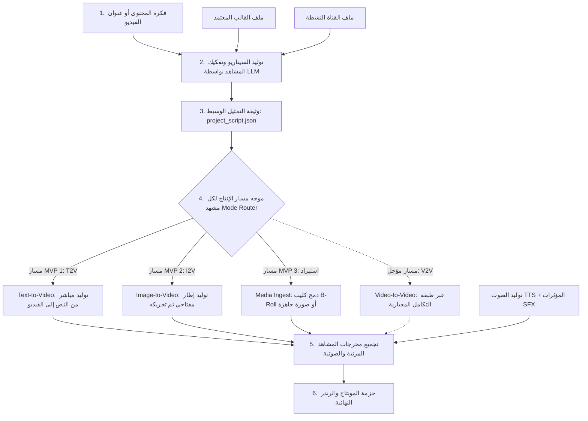

# محرك إنتاج المحتوى التوليدي (AI Content Production Engine)
## استوديو الإنتاج المرئي بالذكاء الاصطناعي | Universal AI Video Production Studio
**تاريخ الوثيقة:** 16 نوفمبر 2026  
**الحالة:** مواصفة هندسية محدثة ومدققة للمرحلة الثانية  

---

## 1. مخطط التدفق متعدد المسارات التوليدية (Multi-Modal Production Pipeline)

تمت هندسة محرك الإنتاج ليدعم **تعددية الوسائط وطرق التوليد (Multi-Modal Generation Pathways)** بشكل معياري:



---

## 2. المسارات التوليدية وتوزيعها بين MVP والإصدارات اللاحقة

### أ. المسارات المعتمدة في النسخة الأولية (In-Scope MVP):
1. **مسار النص إلى فيديو المباشر (Text-to-Video - T2V):**
   * *آلية العمل:* إرسال البرومبت مباشرة إلى محركات الفيديو (مثل Kling أو Luma) لتوليد المشهد في خطوة واحدة.
   * *حالات الاستخدام:* المشاهد السريعة، الطبيعة، الانفجارات، والمقاطع العامة التي لا تتطلب تثبيت ملامح دقيقة.
2. **مسار الصورة إلى فيديو الموجه (Image-to-Video - I2V):**
   * *آلية العمل:* توليد صورة مفتاحية أولاً عبر محرك الصور (مثل FLUX أو Midjourney)، ثم تحريكها بمحرك الفيديو.
   * *حالات الاستخدام:* مسلسلات الكرتون، السرد القصصي، والمشاهد التي تتطلب تثبيت شخصية أو بيئة محددة.
3. **مسار استيراد الوسائط الجاهزة (Direct Media Ingestion):**
   * *آلية العمل:* استيراد مقطع فيديو مسجل أو صورة حقيقية من مكتبة B-Roll ودمجه مباشرة في المشهد دون استهلاك رصيد توليدي، مع ربطه بمسار التراخيص.
   * *حالات الاستخدام:* الوثائقيات، الأخبار، ولقطات الشاشة الواقعية.

### ب. المسار المؤجل وهندسة طبقة التكامل (Deferred V2V Architecture):
* **مسار الفيديو إلى فيديو (Video-to-Video - V2V):**
  * *حالة التنفيذ:* **مؤجل لإصدار لاحق بعد الـ MVP**.
  * *هندسة طبقة التكامل:* تم تصميم واجهة `BaseVideoProvider` بنمط معطيات تجريدي يتضمن توقيع دالة `transform_video(input_video_path, style_prompt, motion_strength)`. يتيح هذا التصميم تفعيل مسار V2V مستقبلاً بمجرد إضافة الـ Adapter الخاص به دون إجراء أي تعديل جوهري على نواة النظام أو مسار الرندر أو واجهة الاستخدام.

---

## 3. وثيقة التمثيل الوسيط المحدثة للمشروع (`project_script.json`)

```json
{
  "project_id": "proj_20261116_001",
  "channel_id": "ch_dreammatter_001",
  "template_id": "tmpl_3d_cartoon_slapstick",
  "title": "When Pizza Attacks Tommy",
  "aspect_ratio": "9:16",
  "supported_aspect_ratios": ["9:16", "1:1", "16:9"],
  "compliance": {
    "coppa_status": "not_made_for_kids",
    "synthetic_media_declaration": true
  },
  "scenes": [
    {
      "scene_index": 1,
      "role": "hook",
      "generation_mode": "image_to_video",
      "duration_seconds": 3.0,
      "visual_description": "A toddler in yellow dungarees gasping as a giant hot pizza stands up.",
      "camera_motion": "fast zoom-in onto the pizza",
      "sfx_cue": ["comic_surprise_sting", "child_gasp"],
      "assets": {
        "keyframe_image": "assets/raw/scene_1_keyframe.png",
        "video_clip": "assets/raw/scene_1_motion.mp4"
      }
    },
    {
      "scene_index": 2,
      "role": "b_roll_context",
      "generation_mode": "direct_media_ingest",
      "duration_seconds": 2.5,
      "source_media_path": "media_vault/kitchen_pan_shot.mp4",
      "assets": {
        "video_clip": "media_vault/kitchen_pan_shot.mp4"
      }
    }
  ]
}
```

---

## 4. خط هندسة وتزامن الصوت المرن

* **التعليق الصوتي (Voiceover):** تحويل النصوص إلى ملف صوتي عبر واجهة TTS، واستخراج طوابع الكلمات الزمنية لمزامنة النصوص.
* **المؤثرات الصوتية (Event-Driven SFX):** ربط المؤثرات الصوتية بلحظات الأحداث الحركية البارزة.
* **إدارة التزامن والتشويه:** التحقق من محاذاة الصوت مع الصورة بتفاوت لا يتجاوز ±40 مللي ثانية، وتطبيق محدد القمة لتفادي التشويه الرقمي.
