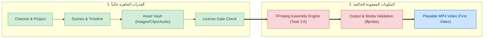

# تقرير الجاهزية والتدقيق الهندسي لإنتاج أول فيديو فعلي
## (First Video MVP Readiness Audit & Scope Reset)
### مشروع: Universal AI Video Production Studio

**تاريخ التقرير:** 16 نوفمبر 2026  
**طبيعة المستند:** تدقيق هندسي وتقييم شامل للجاهزية (Readiness Assessment & Scope Realignment)  
**المبدأ التوجيهي الأساسي (Core Principle):**  
> **"بناء ما هو ضروري حصراً لإنتاج أول فيديو فعلي متكامل وقابل للتشغيل بأسرع وقت ممكن وبأعلى موثوقية، مع تصميم نقاط تمدد نظيفة للميزات المستقبلية دون إفراط هندسي في متطلبات افتراضية."**  
> *(Build what is necessary for the first video. Design clean extension points for future capabilities. Implement advanced features only when real production needs justify them).*

---

## 1. فهرس الجاهزية الفعلي لمكونات النظام (Current Implementation Inventory)

تم فحص الكود المصدري المكتمل والمختبر في بيئة العمل الفعلية (`113 اختباراً شاملاً ناجحاً بنسبة 100%`)، وجرى تصنيف كل قدرة وظيفية بحسب المعايير الخمسة المحددة:

| القدرة الوظيفية (Capability) | حالة التنفيذ الفعلية (Classification) | الأدلة البرمجية في الكود (Source Evidence) | أدلة الاختبارات (Test Evidence) |
| :--- | :---: | :--- | :--- |
| **إدارة القنوات والمشاريع (Channel & Project Management)** | **IMPLEMENTED AND VERIFIED** | [`src/services/channel_service.py`](file:///e:/AI-Projects/universal-ai-video-studio/src/services/channel_service.py)<br>[`src/services/project_service.py`](file:///e:/AI-Projects/universal-ai-video-studio/src/services/project_service.py)<br>[`src/database/repositories/channel_repository.py`](file:///e:/AI-Projects/universal-ai-video-studio/src/database/repositories/channel_repository.py)<br>[`src/database/repositories/project_repository.py`](file:///e:/AI-Projects/universal-ai-video-studio/src/database/repositories/project_repository.py) | `test_channel_service.py` (14 اختباراً)<br>`test_channel_isolation.py` (5 اختبارات)<br>`test_project_scene_and_vault.py` (الأسطر 1–180) |
| **إنشاء وترتيب المشاهد (Scene Creation & Ordering)** | **IMPLEMENTED AND VERIFIED** | [`src/services/scene_service.py`](file:///e:/AI-Projects/universal-ai-video-studio/src/services/scene_service.py)<br>[`src/database/repositories/scene_repository.py`](file:///e:/AI-Projects/universal-ai-video-studio/src/database/repositories/scene_repository.py) | `test_project_scene_and_vault.py` (اختبارات إنشاء المشاهد وتحديثها وإعادة ترتيبها الأسطر 180–310) |
| **إدارة واستيراد وتخزين الوسائط (Media Import & Storage / MAM)** | **IMPLEMENTED AND VERIFIED** | [`src/services/asset_service.py`](file:///e:/AI-Projects/universal-ai-video-studio/src/services/asset_service.py)<br>[`src/database/repositories/asset_repository.py`](file:///e:/AI-Projects/universal-ai-video-studio/src/database/repositories/asset_repository.py)<br>[`src/database/repositories/file_operation_repository.py`](file:///e:/AI-Projects/universal-ai-video-studio/src/database/repositories/file_operation_repository.py) | `test_project_scene_and_vault.py` (إيداع الأصول واحتساب بصمة SHA-256 ومنع التكرار وعزل المسارات)<br>`test_checkpoint_and_recovery.py` (15 اختباراً للتعافي والخزينة) |
| **بوابة التراخيص والتدقيق (License & Quality Gates)** | **IMPLEMENTED AND VERIFIED** | [`src/services/license_service.py`](file:///e:/AI-Projects/universal-ai-video-studio/src/services/license_service.py)<br>[`src/services/audit_service.py`](file:///e:/AI-Projects/universal-ai-video-studio/src/services/audit_service.py)<br>[`src/database/repositories/license_repository.py`](file:///e:/AI-Projects/universal-ai-video-studio/src/database/repositories/license_repository.py)<br>[`src/database/repositories/audit_repository.py`](file:///e:/AI-Projects/universal-ai-video-studio/src/database/repositories/audit_repository.py) | `test_project_scene_and_vault.py` (اختبارات حظر التصدير عند وجود وسائط مجهولة الترخيص وتسجيل الاستثناءات)<br>`test_audit_and_crash_recovery.py` (سلسلة الهاش وقفل التصدير) |
| **طابور المهام وعمال المعالجة (Task Queue & Worker Pool)** | **IMPLEMENTED AND VERIFIED** | [`src/services/task_service.py`](file:///e:/AI-Projects/universal-ai-video-studio/src/services/task_service.py)<br>[`src/services/worker_pool.py`](file:///e:/AI-Projects/universal-ai-video-studio/src/services/worker_pool.py)<br>[`src/services/heartbeat_daemon.py`](file:///e:/AI-Projects/universal-ai-video-studio/src/services/heartbeat_daemon.py)<br>[`src/services/task_reaper.py`](file:///e:/AI-Projects/universal-ai-video-studio/src/services/task_reaper.py) | `test_task_service.py` (14 اختباراً)<br>`test_worker_pool.py` (15 اختباراً)<br>`test_load_and_resumption.py` (8 اختبارات) |
| **نقاط الحفظ والتعافي من الانهيار (Checkpoints & Crash Recovery)** | **IMPLEMENTED AND VERIFIED** | [`src/services/checkpoint_service.py`](file:///e:/AI-Projects/universal-ai-video-studio/src/services/checkpoint_service.py)<br>[`src/services/recovery_service.py`](file:///e:/AI-Projects/universal-ai-video-studio/src/services/recovery_service.py) | `test_checkpoint_and_recovery.py` (15 اختباراً)<br>`test_load_and_resumption.py` (الأسطر 255–363) |
| **الخط الزمني المونتاجي (Timeline / Scene Timeline)** | **IMPLEMENTED AND VERIFIED** | النموذج العلائقي للمشاهد في `SceneModel` مع `scene_index` و `duration_estimate_sec` وربط الأصول البصرية والصوتية والانتقالات. | `test_project_scene_and_vault.py` (التحقق من التسلسل الزمني المنطقي للمشاهد) |
| **استيراد الوسائط الجاهزة يدوياً (Manual Direct Media Ingestion)** | **IMPLEMENTED AND VERIFIED** | مدعوم بالكامل كمسار رسمي معتمد في ADR-002 عبر `AssetService.register_asset` مع التحقق من النوع والبصمة وربطه بالمشاهد. | مختبر ومثبت في `test_project_scene_and_vault.py` |
| **إدارة الفكرة والسيناريو (Idea & Script Management)** | **PARTIALLY IMPLEMENTED** | نصوص السيناريو مدعومة هيكلياً ومخزنة لكل مشهد (`SceneModel.script_text`)، لكن توليد الفكرة والسيناريو آلياً عبر نماذج LLM غير منجز. | التحقق من حفظ واسترجاع نصوص السيناريو في `test_project_scene_and_vault.py` |
| **إعداد البيانات الوصفية والغلاف (Thumbnail & Metadata Prep)** | **PARTIALLY IMPLEMENTED** | بيانات المشروع الأساسية موجودة في `ProjectModel`، لكن حزمة النشر والتصدير المتكاملة (YouTube Manifest & Cover Frame Grab) لم تُبنَ بعد. | لا توجد اختبارات لحزم التصدير النهائية |
| **دمج FFmpeg والرندر الفعلي (FFmpeg Integration & Rendering)** | **NOT IMPLEMENTED** | **لا يوجد أي سطر كود لـ FFmpeg حتى الآن في المشروع**؛ مجلد `src/` يخلو من محرك المعالجة المونتاجية؛ وهو جوهر المهمة 3.6. | غير موجود (مخطط للمهمة 3.6) |
| **توليد الوسائط بالذكاء الاصطناعي (AI Generation Engine)** | **NOT IMPLEMENTED** | مجلد `src/providers/` فارغ (`__init__.py` فقط). لا توجد أدابترز لمزودي الفيديو أو الصور (Runware, Replicate, Fal, Midjourney, إلخ). | غير موجود |
| **معالجة وميكساج الصوت بـ FFmpeg (Audio Mixing & Limiting)** | **NOT IMPLEMENTED** | ربط مسارات الصوت بالـ Scene موجود، لكن كود الميكساج وTrue Peak Limiter خاضع لـ FFmpeg في 3.6 ولم ينفذ. | غير موجود |
| **التحقق من صحة ملف الفيديو النهائي (Export Validation)** | **NOT IMPLEMENTED** | فحص التراخيص مكتمل، لكن الفحص التقني لملف MP4 (عبر ffprobe للتحقق من الكوديك والأبعاد والمدة وقابلية التشغيل) لم يُبنَ. | غير موجود |
| **إدارة الشخصيات المرجعية (Character Anchor Unit)** | **NOT REQUIRED FOR FIRST VIDEO** | وحدة تخصصية اختيارية لحفظ مراجع الشخصيات (Tommy)؛ مؤجلة رسمياً للمرحلة 4 وفق ADR-006 وخارطة الطريق. | غير مطلوبة لأول فيديو |
| **واجهة المستخدم الرسومية (Minimal Local GUI)** | **NOT REQUIRED FOR FIRST VIDEO** | وفق ADR-001 و ADR-010، تبنى واجهة GUI فوق النواة وطبقة الخدمات؛ إنتاج أول فيديو يمكن تنفيذه عبر سطر الأوامر أو سكربت بايثون مباشر يستدعي الخدمات ذاتها. | غير مطلوبة لإنتاج أول ملف فيديو |

---

## 2. القدرات المحققة والجاهزة لخدمة أول فيديو (Verified First-Video Capabilities)

يمتلك المشروع حالياً بنية تحتية هندسية شديدة المتانة والاكتمال تشمل:
1. **عزل القنوات ومساحات العمل:** إنشاء مسارات القنوات، مجلدات الخزينة (`originals`, `cache`, `quarantine`)، وحدود التخزين.
2. **سجل المشاريع والمشاهد:** تنظيم المشروع في مشاهد متسلسلة زمنياً، يحمل كل مشهد نص السيناريو، ومعرفات الوسائط البصرية، ومسار الصوت التوضيحي أو الموسيقى.
3. **خزينة الوسائط الآمنة (MAM):** نظام تخزين محكم يعتمد التسمية الآمنة، حساب بصمات SHA-256، كشف وتفادي تكرار الملفات، والحماية المطلقة للأصول الأصلية من التلف أو الحذف العرضي.
4. **بوابة التراخيص القانونية:** التحقق من وجود تصريح استخدام تجاري لكل وسيط في المشاهد قبل السماح بالوصول لمرحلة الرندر النهائي.
5. **طابور المهام ونقاط الحفظ:** إمكانية تشغيل خطوات الإنتاج كمهام غير متزامنة، مع حفظ تقدم كل مرحلة واستئنافها فوراً دون إعادة الحوسبة في حال حدوث أي مقاطعة.

---

## 3. القدرات الحرجة المفقودة التي تحجب إنتاج أول فيديو (Missing Blocking Capabilities)

لإنتاج أول ملف فيديو حقيقي بصيغة MP4 يمكن النقر عليه وتشغيله على المشغلات القياسية، فإن النواقص تنحصر بدقة في:



### المكونات المفقودة الحاكمة (Critical Blockers):
1. **محرك تجميع ورندر الوسائط (FFmpeg Assembly Engine):**
   - تحويل أصول المشاهد (صور ثابتة بمدد زمنية محددة أو مقاطع فيديو كروية) إلى تيار مرئي موحد بمعدل إطارات وأبعاد قياسية (9:16 أو 16:9).
   - دمج مسار الصوت (تعليق صوتي وموسيقى خلفية) ومطابقته زمنياً مع المشاهد.
   - تطبيق مرشحات الأبعاد القياسية (Scaling & Padding) لمنع تشويه النسب.
   - تصدير الملف بكوديك متوافق عالمياً (H.264 / AAC) داخل حاوية MP4.
2. **محرك التحقق الفني من المخرجات (Media Output Validator):**
   - استخدام `ffprobe` للتحقق البرمجي التلقائي من:
     - سلامة حاوية الفيديو (Non-corrupt container).
     - وجود تيار فيديو وتيار صوت صالحين.
     - مطابقة الأبعاد والمدة الزمنية للمشروع.
     - التأكد من أن حجم الملف أكبر من الصفر وقابل للتشغيل الفوري.

---

## 4. أقصر مسار موثوق لإنتاج أول فيديو (Minimum First-Video Production Path)

تطبيقاً لمبدأ **"Build what is necessary for the first video"** وعدم الاعتماد على استدعاءات خارجية معقدة أو بطيئة قد تعرقل مسار التحقق، يرتكز أقصر مسار على **مسار استيراد الوسائط الجاهزة والمختارة (Direct Media Ingest)** المعتمد رسمياً في القرار المعماري ADR-002:

```
[1. اختيار/إنشاء قناة ومشروع]
       │
       ▼
[2. إنشاء 3 مشاهد بتسلسل زمني (مدة كل مشهد 3-5 ثوانٍ)]
       │
       ▼
[3. استيراد أصول الوسائط للمشروع يدوياً (Direct Ingest)]:
    - 3 صور أو كليبات فيديو تجريبية للمشاهد
    - 1 ملف تعليق صوتي (Voiceover) أو موسيقى خلفية
    - توثيق الترخيص التجاري للأصول (Approved Commercial License)
       │
       ▼
[4. اجتياز بوابة التراخيص (License Gate: Passed)]
       │
       ▼
[5. تشغيل مهمة رندر FFmpeg (FFmpeg Render Task)]:
    - قراءة بيانات المشاهد من SceneService
    - قراءة ملفات الوسائط من AssetService
    - تطبيق الفلتر: Scale to 1080x1920 (9:16), FPS 30, H.264 + AAC
    - دمج الصوت بالصورة
       │
       ▼
[6. فحص وتأكيد سلامة المخرج (ffprobe Output Validation)]
       │
       ▼
[7. إيداع الفيديو النهائي في مجلد التصدير للقناة وتشغيله بنجاح]
```

> [!NOTE]
> **لماذا يمثل هذا أقصر وأضمن مسار؟**
> - يستفيد بنسبة 100% من الوحدات البرمجية المنجزة والمختبرة مسبقاً (`Channel`, `Project`, `Scene`, `Asset`, `License`, `Task Queue`).
> - يعزل المشاكل الفنية بدقة: إذا ركزنا أولاً على إخراج فيديو سليم من صور/كليبات وصوت محلي، سنضمن سلامة محرك المونتاج والرندر قبل إدخال تعقيدات الـ APIs ونماذج التوليد وسرعات الشبكة ومفاتيح الدفع.

---

## 5. نطاق العمل الموصى به للمهمة 3.6 (Recommended Task 3.6 Scope)

بناءً على إعادة ضبط النطاق، يجب تقليص وتركيز نطاق **المهمة 3.6 (FFmpeg Integration & Media Processing)** على الأهداف الجوهرية التالية، وتجنب أي ميزات إضافية معقدة:

### أ. ما يجب تنفيذه في Task 3.6 (In-Scope — Task 3.6):
1. **غلاف ومحرك تنفيذ FFmpeg (`FFmpegWrapper` / `MediaRenderService`):**
   - فحص وتأكيد تثبيت ثنائيات `ffmpeg` و `ffprobe` في النظام.
   - بناء أوامر FFmpeg كـ subprocess مع مهلة زمنية (Timeout) والتقاط المخرجات وسجلات الأخطاء.
2. **رندر خط الإنتاج الأساسي (Base Timeline Renderer):**
   - دمج المشاهد المتسلسلة (Concat Demuxer أو Filtergraph).
   - دعم المدخلات الهجينة: صور ثابتة مع مدة زمنية (Image + Duration) ومقاطع فيديو قصيرة.
   - تطبيق أبعاد Shorts القياسية: **9:16 (1080 × 1920)** و **16:9 (1920 × 1080)**.
   - دمج مسار الصوت المرافق (Audio Overlay / Muxing) بكوديك AAC ومعدل عينات 44.1kHz/48kHz.
3. **تطبيق مانع التشويه ومحدد القمة الرقمية (ADR-003):**
   - استخدام فلتر `loudnorm` أو `alimiter` بقيمة مرجعية `-1.0 dBTP` لضمان خلو الصوت من التشويه.
4. **خدمة التحقق من الوسائط والمخرجات (`MediaProbeService`):**
   - استخدام `ffprobe` لقراءة الميتا-داتا للملف المنتج، والتحقق من صلاحية الحاوية، الأبعاد، الكوديك، ومعدل الإطارات.
5. **مهمة طابور الرندر المتكاملة (`VideoRenderTaskHandler`):**
   - تسجيل مهمة الرندر ضمن طابور المهام `TaskRepository` لتستفيد من نبضات القلب ونقاط الحفظ والتسييج المنجزة في المهمة 3.5.

### ب. ما يجب استبعاده وتأجيله من Task 3.6 (Deferred from Task 3.6):
- تحريك الحلقات الدائرية السردية المعقدة (Seamless Narrative Loops).
- محركات التأثيرات البصرية والانتقالات السينمائية ثلاثية الأبعاد المعقدة (Transitions Shader Engine).
- التكبير والتوسيع التوليدي للكانفاس (Generative Outpainting 4K).
- الحرق الآلي للترجمة الحركية (Animated Karaoke Subtitles Burn-in) — يتم تأجيلها كـ Step إضافي بعد نجاح إنتاج أول فيديو.

---

## 6. متطلبات القابلية للتوسع ونقاط التمدد النظيفة (Extensibility Architecture)

لضمان عدم تحول التبسيط إلى عائق تقني مستقبلي، تم تصميم نقاط التمدد المعمارية كالتالي:

1. **واجهة مزودي التوليد (Pluggable Provider Interface):**
   - إنشاء تجريد بسيط ومحدد داخل `src/providers/base.py`:
     ```python
     class BaseMediaProvider(ABC):
         @abstractmethod
         def generate(self, prompt: str, **kwargs) -> Path: ...
     ```
   - عند الحاجة لإضافة مزود (مثل Gemini أو Runware أو Edge-TTS)، يتم إنشاؤه كـ Adapter يرث من هذه الفئة ويودع ناتجه في `AssetService` دون المساس بنواة الرندر.
2. **تجريد محرك المونتاج (Media Processing Adapter):**
   - فصل استدعاءات FFmpeg داخل `FFmpegAdapter` يرث من واجهة عامة `BaseRenderEngine`، بحيث يمكن مستقبلاً دعم محركات بديلة أو تسريع العتاد (NVENC / QuickSync) بسلاسة.
3. **أنواع المهام القابلة للتوسع (Extensible Task Types):**
   - الاستفادة من بنية طابور المهام في `TaskType`؛ حيث يمكن إضافة مهام جديدة (`SUBTITLE_GENERATION`, `UPSCALE`, `THUMBNAIL_EXTRACTION`) كعقد مستقلة في مخطط DAG دون تعديل محرك الطابور.
4. **مهاجرات قواعد البيانات الآمنة (Versioned Schema Migrations):**
   - نظام المهاجرات المعتمد (`001`, `002`, `003`) جاهز لاستيعاب أي حقول أو جداول جديدة في `004` (مثل إعدادات كوديك الفيديو أو مسارات الترجمة) بأمان تام.

---

## 7. سجل الميزات المؤجلة (Deferred Features Backlog)

| الميزة المؤجلة (Feature) | التبرير الهندسي للتأجيل | متى يتم استدعاؤها وتنفيذها؟ |
| :--- | :--- | :--- |
| **واجهة المستخدم الرسومية (GUI)** | إنتاج أول فيديو لا يتطلب واجهة بصرية؛ طبقة الخدمات الموثقة كافية بالكامل للاختبار والتشغيل. | بعد إنتاج أول فيديو والتحقق من النواة عملياً. |
| **توليد الفيديو بالنصوص (T2V APIs)** | مكلفة وتعتمد على مزودين خارجيين وتزيد نقاط الإخفاق في أول تجربة. | بمجرد عمل محرك FFmpeg بنجاح مع الوسائط المودعة. |
| **توليد الأصوات بالذكاء الاصطناعي (TTS)** | تتطلب اشتراكات ومفاتيح API خارجية. | تضاف كـ Provider Adapter بعد نجاح الرندر. |
| **وحدة اتساق الشخصيات الكرتونية** | تتطلب معايرة معملية دقيقة وتجارب بصرية متعددة (ADR-006). | في المرحلة الرابعة (MAM & Pilot Channel Testing). |
| **حزمة الميتا-داتا المتقدمة والنشر الآلي** | لا تؤثر على قابلية تشغيل ملف الفيديو محلياً. | في مرحلة التجهيز للنشر (المرحلة 5). |

---

## 8. تسلسل التنفيذ المقترح وبوابات الاعتماد (Proposed Implementation Sequence)

```
[ المرحلة الحالية: اعتماد تقرير الجاهزية وضبط النطاق ]
                       │
                       ▼ (بوابة اعتماد المستخدم 1)
[ الخطوة 1: Task 3.6 — بناء محرك FFmpeg والتحقق الفني ffprobe ]
- تنفيذ FFmpegWrapper وفلاتر الأبعاد 9:16 و 16:9
- ميكساج الصوت والحد الرقمي True Peak Limiter
- بناء MediaProbeService للتحقق من المخرجات
- اختبارات وحدة صارمة على ملفات وسائط حقيقية
                       │
                       ▼ (بوابة اعتماد المستخدم 2)
[ الخطوة 2: Task 3.7 — خط الإنتاج التكاملي لإنتاج أول فيديو فعلي ]
- إنشاء مشروع تجريبي كامل لقناة DreamMatter
- استيراد أصول المشاهد والصوت
- تشغيل الرندر عبر طابور المهام
- إنتاج أول ملف MP4 سليم وتشغيله وتوثيق مقاييسه
                       │
                       ▼ (بوابة اعتماد المستخدم 3)
[ الخطوة 3: إضافة أول مزود ذكاء اصطناعي (AI Provider Adapter) ]
- دمج مزود توليد صور أو نصوص أو صوت كـ Step إضافي
```

---

## 9. الإجابة الحاسمة: ما هو الحد الأدنى المطلوب لإنتاج أول فيديو فعلي؟
### (What is the minimum work required to produce our first real video?)

> [!IMPORTANT]
> **الحد الأدنى الحاسم والمطلق لإنتاج أول فيديو فعلي هو:**
> 
> **بناء محرك تجميع ورندر الوسائط بـ FFmpeg ومحرك التحقق الفني `ffprobe` (المهمة 3.6)، وتشغيله فوق المشاهد والأصول المخزنة حالياً في الخزينة، لإنتاج ملف `final_video.mp4` بأبعاد 9:16 صالح وقابل للتشغيل 100%.**
> 
> **لا نحتاج قبل هذا الفيديو الأول إلى:**
> 1. واجهة مستخدم رسومية (GUI).
> 2. اشتراكات ومفاتيح APIs لمولّدات الفيديو السحابية المعقدة (Runware, Sora, Kling).
> 3. خوارزميات اتساق الشخصيات (Face consistency models).
> 4. أدوات التوزيع والنشر الخارجي على يوتيوب وتيك توك.
> 
> **بمجرد إنجاز FFmpeg بنجاح، يصبح لدينا استوديو حقيقي ينتج فيديوهات فعلية من الأصول، ويمكن بعدها توسيع أي مسار توليد ذكاء اصطناعي بكل مرونة وثقة.**

---

> [!CAUTION]
> **التزام الصمت البرمجي وبوابة التوقف (Approval Gate):**
> تم إيقاف أي إجراءات برمجية أو تعديل على الكود. نحن بانتظار مراجعتكم واعتمادكم الصريح لهذا التقرير وخطة ضبط النطاق، للتصريح ببدء **المهمة 3.6 (FFmpeg Integration & Media Processing)** وفق النطاق المركز الجديد.

