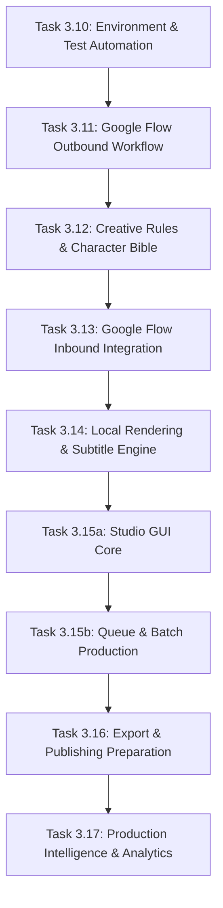

# خارطة طريق استوديو الإنتاج — سياسة Google Flow المعتمدة
## Master Development Roadmap: Google Flow First Edition (Tasks 3.10 – 3.17)

**تاريخ الاعتماد:** 21 نوفمبر 2026  
**المشروع:** Universal AI Video Production Studio  
**المزود التوليدي المعتمد:** Google Flow (كمزود توليد وحيد في المرحلة الحالية)  
**الحالة:** معتمدة رسمياً كمرجع تطويري أساسي للاستوديو

---

## 1. المبادئ الحاكمة لخارطة الطريق

1. **Google Flow First:** يُعتمد Google Flow كمزود التوليد الوحيد بالذكاء الاصطناعي للمشاهد والشخصيات والفيديوهات والصور المدعومة. يُحظر دمج أي مزودات تجارية خارجية بديلة (مثل OpenAI أو Runway أو ElevenLabs) دون مبرر عملي قاهر وموافقة صريحة من المستخدم عبر Adapter مستقل مستقبلاً.
2. **عدم ادعاء تكاملات غير رسمية:** لا يُفترض وجود API عامة غير موثقة لـ Flow. يعتمد الاستوديو على التجهيز الدقيق للمشاريع والبرمبتات وتوجيهات الكاميرا والشخصيات (Outbound) ليستخدمها المستخدم داخل Flow، ثم استيراد ومعالجة مخرجات Flow وملفات Takeout والبيانات الوصفية محلياً (Inbound).
3. **المعالجة والرندر المحلي المستقل:** الاستوديو هو المسؤول الكامل عن تجميع المشاهد، هندسة الصوت ومعايير البث EBU R128، مطابقة التراخيص، إدراج الهوية البصرية، وتوليد الترجمة العربية وتصدير الفيديو النهائي.
4. **حماية المكونات والإنتاجات السابقة:** الحفاظ التام على الحلقات 01 و 02 و 03 والنسخ العربية والإنجليزية، وتطوير المعمارية دون كسر النواة المستقرة الحالية.

---

## 2. جدول تتبع المهام التنفيذية (Tasks 3.10 – 3.17)

---

### Task 3.10 — Environment & Test Automation (أتمتة البيئة والاختبارات)
- **الهدف:** إعداد بيئة تشغيل واختبار مستقرة، قابلة لإعادة الإنتاج 100% على أي جهاز Windows جديد دون الاعتماد على خدمات خارجية.
- **المكونات الأساسية:**
  - تدقيق ملفات التثبيت وإدارة التبعيات (`pyproject.toml`, `.env.example`).
  - عزل اختبارات الوحدة والتكامل لتكون مستقلة تماماً عن اتصال الإنترنت.
  - عدم استهلاك أي أرصدة أو حصص لـ Google Flow في الاختبارات الآلية.
  - الحفاظ التام على اختبارات قبول الحلقات السابقة (Episode 01, 02, 03).
  - إعداد نصوص تشغيل آلية للتحقق من سلامة البيئة وقواعد البيانات والتخزين المحلي.
- **بوابة الاعتماد:** تشغيل دورة اختبارات كاملة تنجح بنسبة 100% محلياً ودون إنترنت.

---

### Task 3.11 — Google Flow Workflow Integration (Outbound Packaging)
- **الهدف:** بناء محرك تجهيز وتصدير البرمبتات وحزم المشاريع لتنفيذها داخل Google Flow.
- **المكونات الأساسية:**
  - نظام حزم البرمبتات (`Project Prompt Packages`): توليد Master Prompt وبرمبتات المشاهد الفردية (`Scene Prompts`).
  - توجيهات الحركة والكاميرا (`Camera & Motion Instructions`) الخاصة بكل مشهد.
  - مراجع الشخصيات والأسلوب البصري (`Character & Style References`).
  - حفظ تاريخ وإصدارات البرمبتات وإعدادات التوليد لكل مشهد لضمان التكرارية وتتبع التجارب.
- **بوابة الاعتماد:** توليد حزمة مشروع متكاملة لقناة DreamMatter جاهزة للإدخال المباشر في Flow مع التحقق من شمولية كافة المتغيرات.

---

### Task 3.12 — Local Creative Rules & Character Bible (محرك القواعد الإبداعية وأطلس الشخصيات)
- **الهدف:** بناء محرك محلي يحافظ على الاتساق الإبداعي والدرامي والبصري للشخصيات والقنوات بين الحلقات.
- **المكونات الأساسية:**
  - أطلس الشخصيات (`Character Bible`): ملفات السمات المظهرية الثابتة، الملابس، التعبيرات، وملفات المراجع (مع الحفاظ الكامل على شخصيات Tommy و Zara وقناة DreamMatter).
  - ملفات تعريف القناة (`Channel Profiles`): النبرة العامة، الإضاءة، الأسلوب البصري، وقواعد الإخراج.
  - قوالب المشاهد والقصص (`Story & Scene Templates`) المعتمدة على بيانات وقواعد مهيكلة دون استهلاك LLM خارجي.
- **بوابة الاعتماد:** التحقق من قدرة النظام على توليد تعليمات مشهدية تحافظ على ملامح الشخصية بنسبة 100% عبر مواقف مختلفة.

---

### Task 3.13 — Google Flow Inbound & Media Integration (مستورد مخرجات Flow)
- **الهدف:** بناء مستورد ذكي وآمن لاستيعاب نتائج التوليد وملفات المشاريع القادمة من Google Flow.
- **المكونات الأساسية:**
  - دعم استيراد الفيديوهات والصور وتنسيقات Google Takeout والبيانات الوصفية المصاحبة (JSON).
  - مطابقة الوسائط بالمشاهد (`Scene-to-Asset Mapping`) وربطها بنظام إدارة الأصول MAM و `StorageService`.
  - معالجة ذرية مع إزالة التكرار بالـ SHA-256 وحفظ البيانات الوصفية حتى للحقول غير القياسية.
  - رصد وتسجيل الملفات غير المطابقة دون حذفها لمنع فقدان أي مخرج إنتاجي.
- **بوابة الاعتماد:** استيراد حزمة مخرجات تجريبية وربطها بمشاهد حلقة تلقائياً وتوثيقها في قاعدة البيانات.

---

### Task 3.14 — Local Rendering, Audio & Subtitle Engine (محرك الرندر المحلي وهندسة الصوت والترجمة)
- **الهدف:** تطوير محرك التجميع النهائي لإنتاج فيديو احترافي بمواصفات بث عالمية.
- **المكونات الأساسية:**
  - دعم الانتقالات البصرية (`xfade`) وأوضاع الملاءمة (`cover` / `contain` / `blur-pad`) في FFmpeg مباشرة دون MoviePy.
  - محرك الترجمة البصرية المتقدم: دعم اللغة العربية الأصيل (الاتجاه من اليمين لليسار RTL، وتشكيل الحروف المتصلة)، وتخصيص الخطوط والحدود Stroke والألوان وصناديق الخلفية.
  - هندسة الصوت والموسيقى المرخصة: دعم تعليق Flow الصوتي والتسجيلات المحلية المرخصة مع الحفاظ على أصوات Enzo و Riko و Cruz، والالتزام بمعايير EBU R128 وحراسة True Peak $\le -1.0\text{ dBTP}$.
  - الرندر الجزئي (`Incremental Rendering`): إعادة رندر المشاهد المتغيرة فقط واسترجاع العمليات المتعثرة.
- **بوابة الاعتماد:** إنتاج فيديو كامل يحتوي على انتقالات وترجمة عربية منسقة وموسيقى مطابقة لمعايير الصوت.

---

### Task 3.15 — Studio GUI & Batch Production (واجهة الاستوديو والإنتاج بالدفعات)
- **الهدف:** بناء واجهة مستخدم رسومية محلية متكاملة وسهلة الاستخدام لإدارة الإنتاج.
- **المراحل:**
  - **Task 3.15a (نواة الواجهة وإدارة المشاريع):** لوحة تحكم القنوات، محرر السيناريو واللوحة القصصية (Storyboard)، أطلس الشخصيات، وإدارة حزم Flow.
  - **Task 3.15b (طابور الإنتاج والدفعات):** إدارة طابور المهام، تشغيل الدفعات المتعددة، معاينة الفيديو المباشرة، ومتابعة تقدم الرندر واستئناف المهام.
- **الضوابط الصارمة:** كل زر في الواجهة يرتبط بوظيفة خلفية حقيقية عبر طبقة الخدمات (`Service Layer`)، مع استمرار قدرة النظام على العمل بدون واجهة (Headless CLI).

---

### Task 3.16 — Export & Publishing Preparation (تجهيز التصدير وحزم النشر)
- **الهدف:** إعداد الفيديوهات وحزم النشر للمنصات الرقمية المختلفة.
- **المكونات الأساسية:**
  - قوالب تصدير مخصصة لكل قناة ولأبعاد متعددة (9:16 Shorts, 16:9 Landscape, 1:1 Square).
  - إنشاء حزم النشر الشاملة: توليد العناوين، الوصف، الوسوم (Tags)، والصور المصغرة (Thumbnails) مع العلامة المائية.
  - بوابة التحقق القانوني النهائي للتراخيص قبل حزم التصدير النهائي.
- **بوابة الاعتماد:** توليد حزمة نشر كاملة جاهزة للرفع اليدوي أو المؤتمت مع مطابقة تامة للهوية والتراخيص.

---

### Task 3.17 — Production Intelligence & Resource Tracking (ذكاء الإنتاج وتتبع الموارد) — مكتملة بنسبة 100% 🟢
- **الهدف:** لوحة بيانات تحليلية ونظام استخبارات تشغيلي موحد لمراقبة كفاءة الإنتاج، التكاليف، واستهلاك الموارد والأرصدة.
- **المكونات الأساسية المنجزة:**
  - هجرة قاعدة البيانات Migration 9 (`009_task_3_17_production_intelligence`) لإنشاء جداول دفتر الأستاذ `flow_credit_ledger` وتكوينات تكلفة الإنتاج `production_cost_configurations`.
  - طبقة البيانات والخدمات الحتمية `IntelligenceRepository` و `IntelligenceService` مع الامتثال الصارم لـ ADR-008 و ADR-012 و ADR-013.
  - مراقبة الموارد المحلية وحساب البصمة التخزينية بدقة وتجريدها حسب القناة والفئة (Image, Video, Audio, Exports, Temp) وحالة خادم الاستضافة (Host System Resources) دون تسريب مسارات النظام الحساسة.
  - محرك تكاليف إنتاج متطور يفصل فصلاً قاطعاً بين التكلفة الحقيقية المعروفة (Actual Known Cost $0.00 افتراضياً ما لم تُدفع) والتكلفة المقدرة (Estimated Cost) عبر معدلات تكلفة وحدة المشهد/الدقيقة القابلة للتخصيص لكل قناة.
  - سجل أرصدة Google Flow اليدوي المدقق والمحمي ضد التعديل (Immutable Audit Log) بوسم صريح "Manual User Entry" دون أي ادعاء استعلامات غير رسمية.
  - تحليلات أداء مهام الرندر والإنتاج بالدفعات (زمن التنفيذ، معدلات النجاح، معدلات إعادة المحاولة والفشل، ومعالجة القيم غير المقاسة كـ "Not Recorded").
  - محرك الرؤى والتنبيهات التشغيلية الحتمي 100% (Deterministic Production Insights Engine) بدون أي LLM خارجي.
  - خط زمني موحد لتاريخ الإنتاج والإصدارات (Unified Production Timeline) يجمع المهام، اللقطات، حزم التصدير، وحركات الأرصدة بترتيب زمني موحد.
  - تصدير التقارير الآمنة بصيغ JSON و CSV و Markdown مع حماية كاملة من هجمات تخطي المسار (Path Traversal Protection) وتطابق تام للإجماليات 100%.
  - واجهة ويب كاملة `/intelligence` مع بطاقات المؤشرات الرئيسية KPI، ورسوم بيانية لنسب التخزين، وجداول سجل الأرصدة، وتكوين التكاليف، وإدماج بطاقة استخبارات في لوحة التحكم الرئيسية `/dashboard`.
  - واجهة أوامر CLI متكاملة (`src/cli/intelligence.py`) لأوامر `summary` و `export` و `credit` و `cost`.
- **بوابة الاعتماد:** اجتياز 15 اختباراً شاملاً في [`tests/test_task_317_intelligence.py`](file:///E:/AI-Projects/universal-ai-video-studio/tests/test_task_317_intelligence.py) واجتياز 252 اختباراً محمولاً + 13 اختبار قبول إنتاج محلي (إجمالي 265 اختباراً) بنسبة 100% دون أي انحدار، وتوليد تقارير تحليلية شاملة لقناة DreamMatter.

---

## 3. اكتمال خارطة طريق الاستوديو (Phase 3 Roadmap Completion) 🏁

بانعقاد واعتماد **Task 3.17**، تكتمل رسمياً كافة المهام الهندسية المنصوص عليها في خارطة طريق استوديو الفيديو الذكي (`Phase 3: Core Engine Development & Integration` من Task 3.1 إلى Task 3.17)، ليصبح النظام منصة إنتاج وسائط متعددة متكاملة وذاتية الاستضافة بمحرك رندر محلي، وتكامل Google Flow، وحوكمة وتراخيص صارمة، وواجهة ويب ثنائية اللغة، وذكاء تشغيلي متكامل.

---

## 3. قواعد الانتقال وبوابات الموافقة (Approval Gates)

- **التنفيذ التتابعي الصارم:** تنفيذ مهمة واحدة في كل مرة؛ يُحظر البدء في أي مهمة جديدة قبل اعتماد المهمة الحالية وإجراء اختباراتها وتوثيقها.
- **عدم الرفع أو الحفظ دون إذن:** لا يتم تنفيذ `git commit` أو `git push` إلا بعد مراجعة وموافقة المستخدم النهائية.

