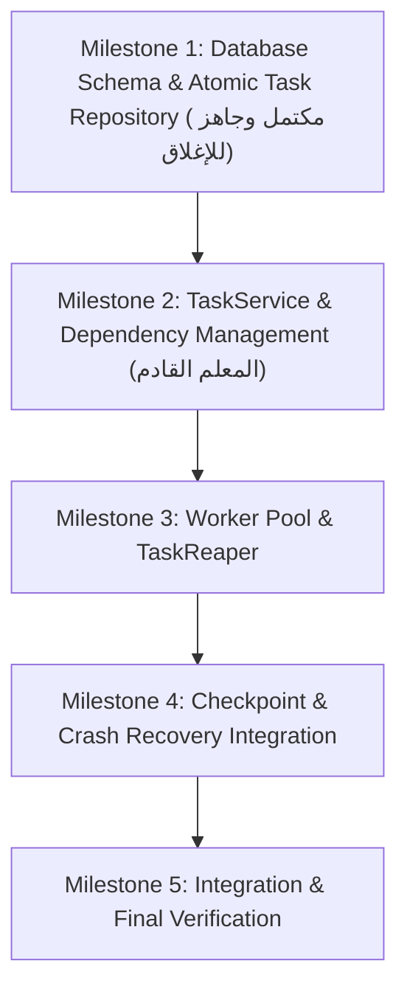

# تقرير تدقيق التحقق والامتثال النهائي: المعلم الأول — المهمة 3.5
## Task 3.5 — Milestone 1: Final Scope Compliance & Verification Audit
### Database Schema, Task Models & Atomic Task Repository

**تاريخ التدقيق:** 16 نوفمبر 2026  
**المرحلة المعمارية:** المهمة 3.5 — المرحلة 2: المعلم الأول (Task 3.5 — Stage 2: Milestone 1)  
**نوع الوثيقة:** مراجعة تحقق وتدقيق امتثال صارمة ومستقلة (Strict Scope & Technical Verification Audit)  
**الحالة:** 🟢 **جاهز للاعتماد والإغلاق النهائي للمعلم الأول والانتقال لاعتماد المعلم الثاني (M2)**  

---

## 1. قيود المراجعة والالتزام الإجرائي (Audit Boundaries)

تمت المراجعة بالالتزام الحرفي بالقيود التالية:
- **عدم تعديل أي كود برمجي** في حزمة المشروع.
- **عدم تعديل أي قاعدة بيانات** تشغيلية أو تشغيل Migrations خارج البيئات المؤقتة للاختبارات.
- **عدم حذف أو نقل أي ملفات**.
- **عدم البدء بأي أعمال تخص المعلم الثاني (M2)** أو أي معلم لاحق.
- المراجعة تقتصر على الفحص الدقيق والتوثيق والتحقق التقني المستقل.

---

## 2. مراجعة الالتزام بنطاق التفويض (Scope Compliance Review)

تم فحص العناصر الخمسة الواردة في تقرير الإنجاز للتحقق من موقعها المعماري وحدودها التنفيذية:

| العنصر المفحوص | الملف المسؤول والأسطر | الوظيفة الفعلية | التصنيف المعماري (Primitive vs Service) | هل يدخل ضمن تفويض M1 الأصلي؟ | هل تضمن تنفيذاً لـ M2 أو M3 أو M4؟ |
| :--- | :--- | :--- | :--- | :--- | :--- |
| **`reap_stale_task()`** | [`src/database/repositories/task_repository.py`](file:///E:/AI-Projects/universal-ai-video-studio/src/database/repositories/task_repository.py#L438-L505) | تحديث ذري لسجل المهمة (`running` -> `retry_pending`) مع زيادة `execution_token` وحذف الإيجار بشرط مطابقة `stale_token` و`stale_worker_id`. | **Repository-level Primitive فقط.** مجرد استعلام SQL مباشر داخل معاملة ذرية. لا يحتوي على حلقة تكرارية، ولا Daemon، ولا فحص دوري، ولا حسابات Backoff. | **نعم (مصرح به):** يمثل واجهة وصول البيانات (Data Access Primitive) الضرورية لضمان ذرية الـ Fencing Token في قاعدة البيانات. | **لا.** لم يُنفذ `TaskReaper` كخدمة خلفية دورية أو Worker Scheduler (وهذا مؤجل كلياً لـ M3). |
| **`save_checkpoint()`** | [`src/database/repositories/task_repository.py`](file:///E:/AI-Projects/universal-ai-video-studio/src/database/repositories/task_repository.py#L507-L593) | إدخال أو تحديث ذري (`ON CONFLICT DO UPDATE`) في جدول `task_checkpoints` مع التحقق من مطابقة `execution_token` وحالة `RUNNING`، وتحديث مؤشر تقدم المهمة. | **Repository-level Primitive فقط.** استعلام SQL لحفظ بيانات الخطوة. لا يدير مسار الخطوات، ولا التراجع عند الفشل، ولا فحص الملفات على القرص. | **نعم (مصرح به):** واجهة CRUD لقاعدة البيانات لدعم حفظ نقاط الاستئناف المرتبطة بجدول المهام. | **لا.** لا يتضمن خوارزميات الاستئناف والتعافي من الانهيار (Crash Recovery Integration المؤجلة لـ M4). |
| **جدول ونماذج `task_checkpoints`** | [`src/database/migrations.py`](file:///E:/AI-Projects/universal-ai-video-studio/src/database/migrations.py#L255-L267)<br>[`src/database/models.py`](file:///E:/AI-Projects/universal-ai-video-studio/src/database/models.py#L380-L408) | جدول ومخطط علائقي ونماذج Pydantic لحفظ بيانات الخطوات المرحلية `(task_id, step_name, step_index, step_data_json, execution_token)`. | **Schema & Data Model فقط.** بنية بيانات ساكنة دون منطق تشغيلي. | **نعم (مصرح به صراحة):** ضمن التفويض الصريح لـ Migration 003 ونماذج البيانات. | **لا.** مجرد جدول ساكن ونموذج بيانات، ولا يمتلك أي محرك استئناف. |
| **`last_task_dispatched_at`** | [`src/database/migrations.py`](file:///E:/AI-Projects/universal-ai-video-studio/src/database/migrations.py#L204)<br>[`src/database/repositories/task_repository.py`](file:///E:/AI-Projects/universal-ai-video-studio/src/database/repositories/task_repository.py#L188,L239-L242) | عمود زمني في جدول `channels`؛ يُستخدم كمعيار ترتيب في استعلام المطالبة الذرية لمنع تجويع القنوات، ويُحدث عند كل مطالبة ناجحة. | **Database Column & Query Clause.** جزء من منطق الفرز داخل الاستعلام الذري للمطالبة. | **نعم (مصرح به):** منصوص عليه صراحة في وثيقة التصميم المعتمدة كآلية للجدولة العادلة (Fair Scheduling). | **لا.** لا يوجد Scheduler خارجي أو معالج مهام، بل فرز SQL مباشر أثناء `atomic_claim_next_task`. |
| **تنظيف الحجوزات عند الإقلاع** | [`src/database/repositories/task_repository.py`](file:///E:/AI-Projects/universal-ai-video-studio/src/database/repositories/task_repository.py#L171,L612-L619) | تنفيذ `DELETE FROM active_channel_leases WHERE lease_expires_at <= ?` ذرّياً في بداية عملية المطالبة وكتوفير دالة مساعدة `clean_expired_leases`. | **Repository SQL Statement.** جملة SQL للحذف الفوري للإيجارات المنتهية. | **نعم (مصرح به):** مشمول ضمن تفويض إدارة دورة حياة الإيجارات الذرية لقناة البيانات (Channel Leases). | **لا.** لم يُبنَ Startup Manager أو Lifecycle Hook تشغيلي للتطبيق؛ بل يُستدعى الاستعلام عند طلب المطالبة فقط. |

**الخلاصة:** جميع العناصر الخمسة هي **Repository-level Primitives ساكنة** تخدم سلامة البيانات والتحقق الرياضي من الأقفال داخل SQLite، ولا يوجد أي تنفيذ لخدمات أو عمال أو معالجات تخص Milestones 2 أو 3 أو 4.

---

## 3. تدقيق التزامن والحجوزات (Concurrency, Leases & Fencing Token Audit)

تم فحص كود المعاملات ومستودع المهام للتحقق من الشروط الصارمة:

1. **معاملة `BEGIN IMMEDIATE` للمطالبة الذرية:**
   - **التحقق:** في [`src/database/connection.py`](file:///E:/AI-Projects/universal-ai-video-studio/src/database/connection.py#L69-L75)، مدير المعاملات ينفذ صراحة `conn.execute("BEGIN IMMEDIATE;")` عند فتح أي سياق `with self.db_manager.transaction()`.
   - في [`src/database/repositories/task_repository.py`](file:///E:/AI-Projects/universal-ai-video-studio/src/database/repositories/task_repository.py#L167)، تستخدم الدالة `atomic_claim_next_task` هذا السياق، مما يضمن حجز قفل الكتابة على مستوى SQLite ومنع أي سباق بين العمليات.

2. **الذرية المطلقة بين تحديث المهمة وحجز القناة:**
   - **التحقق:** داخل نفس المعاملة (الأسطر 167–246)، يتم تنفيذ تنظيف الإيجارات المنتهية، ثم تحديث حالة المهمة إلى `running` مع زيادة التوكن، ثم إدراج الإيجار في `active_channel_leases`، ثم تحديث زمن إرسال القناة. إذا فشلت أي خطوة أو حدث تعارض، يتم عمل `ROLLBACK` تلقائي للمعاملة بأكملها، مما يمنع تجزئة الحالة.

3. **منع تعدد الحجوزات لنفس القناة على مستوى المحرك (DB Constraint):**
   - **التحقق:** جدول `active_channel_leases` معرّف كالتالي:
     `channel_id TEXT PRIMARY KEY REFERENCES channels(id) ON DELETE CASCADE`.
     وجود `PRIMARY KEY (channel_id)` يجعل من المستحيل رياضياً وتقنياً على محرك SQLite قبول أكثر من حجز نشط واحد لنفس القناة، ويرمي `sqlite3.IntegrityError` فوراً عند أي محاولة تكرار، والتي تلتقطها الشيفرة وتحولها إلى `ChannelLeaseConflictException`.

4. **التحقق الصارم من رباعية المفاتيح عند التجديد والتحرير:**
   - **التجديد (`renew_lease`):** يشترط تطابق:
     `WHERE channel_id = ? AND task_id = ? AND worker_id = ? AND execution_token = ?` (الأسطر 298–305).
   - **التحرير (`release_lease`):** يشترط تطابق نفس الرباعية:
     `WHERE channel_id = ? AND task_id = ? AND worker_id = ? AND execution_token = ?` (الأسطر 345–350).

5. **منع العامل القديم (Stale Worker) من تعديل الحالة:**
   - **التحقق:** في `update_task_status` (الأسطر 396–399)، يتم جلب التوكن الحالي من قاعدة البيانات؛ فإذا اختلف عن `execution_token` الخاص بالعامل، يُرمى استثناء `StaleExecutionTokenException` وتُلغى العملية فوراً دون أي تعديل. بالإضافة إلى ذلك، فإن استعلام `UPDATE` يشترط `WHERE id = :task_id AND execution_token = :execution_token`.

6. **منع عملية قديمة أو Reaper قديم من تحرير حجز عامل أحدث:**
   - **التحقق:** في `reap_stale_task` (الأسطر 478–504)، لا يتم تعديل المهمة إلا إذا كانت `execution_token = :stale_token`، ولا يتم حذف الإيجار إلا إذا تطابق `task_id` و`stale_worker_id` و`stale_token`. إذا استلم عامل أحدث المهمة، تتغير قيمة التوكن ويصبح استعلام الحذف غير مؤثر (0 rows affected).

7. **شفافية اختبارات التزامن (Threads vs Multiprocess):**
   - **إقرار شفاف وصريح:** جميع اختبارات التزامن المنفذة في [`tests/test_task_repository.py`](file:///E:/AI-Projects/universal-ai-video-studio/tests/test_task_repository.py) (مثل `test_atomic_claim_concurrency` و`test_sqlite_busy_handling`) أُجريت حصراً باستخدام **`threading.Thread`** (تزامن متعدد الخيوط يفتح اتصالات SQLite مستقلة على ملف قاعدة بيانات مشترك).
   - **لم يتم تشغيل أي اختبار Multiprocess (عبر `multiprocessing.Process` أو عمليات OS منفصلة)** في هذه المرحلة. اختبارات Multiprocess الحقيقية مؤجلة لتُنفذ أثناء بناء حوض العمال في المعلم الثالث (M3: Worker Pool).

---

## 4. تدقيق ترحيل قاعدة البيانات (Migration 003 Audit)

1. **الجداول والأعمدة المضافة:**
   - `tasks`: 24 عموداً مع القيد الفريد `UNIQUE (channel_id, idempotency_key)`.
   - `active_channel_leases`: 5 أعمدة مع المفتاح الأساسي `channel_id TEXT PRIMARY KEY`.
   - `task_checkpoints`: 7 أعمدة مع القيد الفريد `UNIQUE (task_id, step_name)`.
   - `channels`: إضافة عمود `last_task_dispatched_at TEXT` عبر `ALTER TABLE`.

2. **الفهارس المضافة:**
   - `idx_tasks_dequeue` على `(status, scheduled_at, priority DESC, created_at ASC)`.
   - `idx_tasks_channel_status` على `(channel_id, status)`.
   - `idx_tasks_reaper` على `(status, lease_expires_at) WHERE status = 'running'`.
   - `idx_tasks_pending_deps` على `(status, channel_id) WHERE status = 'pending'`.
   - `idx_tasks_project` على `(project_id)`.
   - `idx_leases_expires` على `(lease_expires_at)`.
   - `idx_checkpoints_task` على `(task_id, step_index ASC)`.

3. **التوافقية وسلامة البيانات:**
   - ترقية المخطط مسجلة كنسخة 3 في قائمة `MIGRATIONS` في [`src/database/migrations.py`](file:///E:/AI-Projects/universal-ai-video-studio/src/database/migrations.py).
   - إضافة العمود لجدول `channels` تمت عبر `ALTER TABLE channels ADD COLUMN last_task_dispatched_at TEXT;` وهي عملية ساكنة وغير مقفلة في SQLite تعطي قيمة افتراضية `NULL` لجميع السجلات القديمة، دون إعادة كتابة الجدول أو التسبب في أي خطر لفقدان البيانات.
   - **بيئة الاختبار:** جرى اختبار الترحيل حصراً على قواعد بيانات مؤقتة معزولة أنشأتها بيئة `tempfile.TemporaryDirectory` أثناء تنفيذ الاختبارات، ولم يتم تشغيل الترحيل مطلقاً على أي قاعدة بيانات تشغيلية.

---

## 5. تدقيق الاختبارات المنفذة (Test Audit & Execution Evidence)

### 5.1 الأمر المنفذ والنتائج
- **أمر تشغيل الاختبارات الشامل:**
  ```powershell
  python -m unittest discover -s tests -p "test_*.py" -v
  ```
- **إجمالي الاختبارات:** 61 اختباراً.
- **الاختبارات الناجحة:** 61 (بنسبة 100%).
- **الاختبارات الفاشلة:** 0.
- **زمن التنفيذ الكلي:** 8.265 ثوانٍ.

### 5.2 توزيع الاختبارات
1. **اختبارات Tasks 3.1 إلى 3.4 (السابقة):** 49 اختباراً — **تم الحفاظ عليها كاملة ونجحت بنسبة 100%**، وتغطي:
   - عزل القنوات والبيانات (Channel Data Isolation).
   - إدارة المشاريع والمشاهد وإعادة الترتيب الذري.
   - إدارة الأصول والتراخيص (MAM & Licensing Engine).
   - بوابة التصدير الصارمة (Export Gate).
   - التعافي من الانهيار وسجل التدقيق المتسلسل (Outbox & Crash Recovery Journal).
2. **اختبارات Task 3.5 — Milestone 1 (الجديدة):** 12 اختباراً في [`tests/test_task_repository.py`](file:///E:/AI-Projects/universal-ai-video-studio/tests/test_task_repository.py):
   - `test_idempotent_task_creation`: منع تكرار المهام مع نفس مفتاح الـ Idempotency.
   - `test_atomic_claim_concurrency`: تسابق 10 Threads للمطالبة بـ 10 مهام دون تصادم.
   - `test_intra_channel_serialization`: منع تشغيل مهمتين لقناة واحدة بالتزامن.
   - `test_inter_channel_parallelism`: تشغيل مهام قنوات مختلفة بالتوازي.
   - `test_stale_worker_renew_lease_blocked`: حظر تجديد الإيجار بالتوكن القديم.
   - `test_stale_worker_status_update_blocked`: رمي `StaleExecutionTokenException` عند محاولة التحديث بتوكن ملغى.
   - `test_reaper_cannot_release_newer_worker_lease`: حماية إيجار العامل الأحدث من مساس الـ Reaper القديم.
   - `test_atomic_lease_release_on_completion`: حذف الإيجار ذرياً عند اكتمال المهمة.
   - `test_sqlite_busy_handling`: صمود المعاملات أثناء تزاحم الخيوط مع busy_timeout.
   - `test_cold_boot_lease_cleanup`: تنظيف الإيجارات منتهية الصلاحية عند المطالبة الأولى.
   - `test_step_checkpointing_with_token`: حفظ نقاط الاستئناف وتحديث التقدم وحمايتها بالتوكن.
   - `test_fair_scheduling_round_robin`: عدالة الجدولة بناءً على القناة الأقدم نشاطاً.

### 5.3 السيناريوهات التي لم تُختبر بعد (Untested Scenarios)
لتجنب أي ادعاء غير دقيق، نؤكد أن السيناريوهات التالية **لم تُختبر بعد** لأنها تقع خارج نطاق M1 ومجدولة في المعالم القادمة:
1. **Multiprocess Concurrency:** اختبار تسابق عمليات OS حقيقية منفصلة عبر الذاكرة على نفس ملف قاعدة البيانات (مؤجل لـ M3).
2. **Dependency Graph Resolution:** حل تبعيات المهام تلقائياً ونقل الحالة من `PENDING` إلى `QUEUED` عند اكتمال التبعيات (مؤجل لـ M2).
3. **Heartbeat Daemon Background Pulse:** حلقة مؤقتة في خيط خلفي ترسل نبضات القلب كل N ثانية (مؤجل لـ M3).
4. **Crash Recovery Reconciliation with Disk Files:** مصالحة ملفات الأصول غير المكتملة على القرص عند الاستئناف بعد الانهيار (مؤجل لـ M4).

---

## 6. تصحيح خارطة معالم المهمة 3.5 (Corrected Milestone Roadmap)

وفقاً للتوجيه المعماري المعتمد، تم تصحيح الخارطة المعمارية الصارمة للمهمة 3.5 لتكون كالتالي:



- **M1 (الحالي):** Database Schema, Task Models & Atomic Task Repository — **مكتمل 100% ويخضع للاعتماد النهائي الآن**.
- **M2 (التالي):** `TaskService & Dependency Management` (إنشاء المهام من المشاريع والمشاهد، حل التبعيات، إدارة التحولات، ومطابقة مفاتيح Idempotency على مستوى الخدمة).
- **M3:** `Worker Pool & TaskReaper` (حوض العمال، العمليات المتعددة Multiprocessing، نبضات القلب التلقائية، وخدمة Reaper الدورية).
- **M4:** `Checkpoint & Crash Recovery Integration` (استئناف الخطوات، مصالحة الملفات المؤقتة والنهائية مع `file_operations` والـ Media Vault).
- **M5:** `Integration & Final Verification` (التكامل النهائي واختبار خط الإنتاج الشامل وإغلاق المهمة 3.5).

---

## 7. المخاطر والقيود المتبقية (Remaining Risks & Constraints)

1. **انعدام طبقة الأعمال (Service Layer):** لا يوجد حالياً سوى الـ Repository؛ وبالتالي لا يمكن استهلاك الطابور أو جدولة المهام بأمان من قبل التطبيق دون وجود `TaskService` (المستهدف في M2).
2. **غياب حل التبعيات (Dependencies):** عمود `dependencies_json` موجود في قاعدة البيانات، ولكن منطق تقييم اكتمال المهام التابعة لم يُبنَ بعد (مستهدف في M2).
3. **عدم اختبار التزامن عبر العمليات (Cross-Process Locks):** على الرغم من أن `BEGIN IMMEDIATE` و`busy_timeout=10,000ms` يضمنان سلامة القفل على مستوى نظام الملفات، إلا أن التحقق الفعلي عبر عمليات OS متعددة يتطلب اختبارات M3.

---

## 8. التوصية النهائية وبوابة الاعتماد (Final Recommendation & Approval Gate)

### التوصية:
**جاهز للإغلاق والاعتماد النهائي (Ready to Close & Approve).**
أثبت التدقيق أن جميع المخرجات البرمجية مطابقة تماماً للمواصفات المعمارية، ولا تحتوي على أي تجاوز لحدود التفويض، وأن حزمة الاختبارات تعمل بنجاح 100% (61/61 اختباراً) دون أي تراجعات.

### حالة بوابة العبور (Approval Gate Status):
🛑 **النظام متوقف تماماً عند بوابة الاعتماد.**
- لن يتم إنشاء أو تعديل أي كود جديد.
- لن يتم البدء في المعلم الثاني (M2: TaskService & Dependency Management) أو حوض العمال أو أي مهمة أخرى إلا بعد صدور **الموافقة الصريحة والتفويض المكتوب** من المستخدم.

