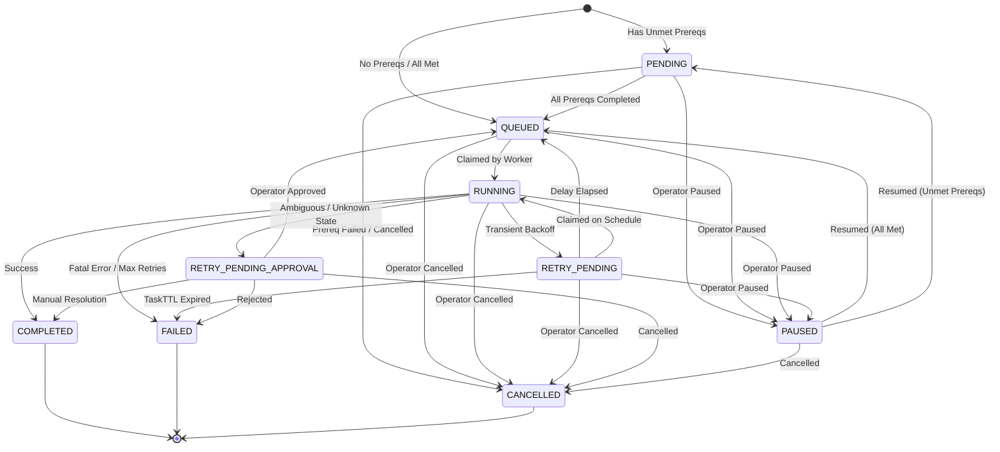

# تقرير تدقيق التحقق والامتثال الهندسي النهائي: المعلم الثاني — المهمة 3.5
## Task 3.5 — Milestone 2: Final Verification Audit
### TaskService, Dependency Management & Lifecycle State Machine

**تاريخ التدقيق:** 16 نوفمبر 2026  
**المرحلة المعمارية:** المهمة 3.5 — المرحلة الثانية: المعلم الثاني (Task 3.5 — Stage 2: Milestone 2)  
**نوع الوثيقة:** مراجعة هندسية وتدقيق امتثال صارم ومستقل (Strict Engineering Verification Audit)  
**القرار النهائي للتدقيق (Final Verdict):** 🟢 **PASS (اعتماد وموافقة تامة مع توصيات تصميمية لمعلم M3)**  

---

## 1. الالتزام بنطاق التفويض (Scope Compliance)

تم فحص ومقارنة الكود المنفذ في المعلم الثاني مقابل وثيقة التفويض الصادرة:
- **المكونات المصرح بها والمنفذة:**
  - بناء خدمة `TaskService` في [`src/services/task_service.py`](file:///E:/AI-Projects/universal-ai-video-studio/src/services/task_service.py).
  - إدارة الاعتماديات والمخططات الموجهة عديمة الحلقات (DAG Management & 3-Color DFS Cycle Detection).
  - مصفوفة آلة تحولات الحالة الصارمة لكافة الحالات التسع (`ALLOWED_TRANSITIONS`).
  - التحقق من نطاق القناة والمشروع والمشهد وفق [ADR-005](file:///E:/AI-Projects/universal-ai-video-studio/docs/decisions/005-channel-data-isolation.md).
  - التعامل مع Idempotency على مستوى الخدمة.
  - استثناءات `InvalidStateTransitionException` و`CyclicDependencyException` في [`src/core/exceptions.py`](file:///E:/AI-Projects/universal-ai-video-studio/src/core/exceptions.py).
- **الالتزام بالممنوعات المعمارية:**
  - لم يتم بناء حوض العمال `WorkerPool` أو معالجات العمال `WorkerThread` أو `WorkerProcess` (M3).
  - لم يتم إنشاء حلقة نبضات القلب التلقائية `Heartbeat Daemon` في خيط خلفي (M3).
  - لم يتم تنفيذ `TaskReaper` كخدمة دورية خلفية (M3).
  - لم يتم البدء بدمج نقاط الاستئناف مع التعافي من الانهيار (M4).
  - لم يتم استدعاء أو ربط أي مزود ذكاء اصطناعي أو محرك FFmpeg (Task 3.6).
  - لم يُستخدم Redis أو Celery.
  - لم يتم تعديل قاعدة بيانات الإنتاج أو تغيير المخطط العلائقي (Schema) المعتمد في M1.

---

## 2. فحص وتدقيق الكود المصدري (Source-Code Inspection Findings)

| الملف المفحوص | المسؤولية الفعلية في الكود | تقييم الفصل المعماري والنزاهة |
| :--- | :--- | :--- |
| [`src/services/task_service.py`](file:///E:/AI-Projects/universal-ai-video-studio/src/services/task_service.py) | إدارة دورة حياة المهام، التحقق من الحمولات ونطاق القنوات، كشف الدورات، وإلغاء وترقية المهام التابعة. | **ممتاز.** فصل تام بين منطق الأعمال واستعلامات SQLite؛ لا يحتوي الكود على أي استعلام SQL مباشر بل يفوض التخزين لمستودع البيانات. |
| [`src/database/repositories/task_repository.py`](file:///E:/AI-Projects/universal-ai-video-studio/src/database/repositories/task_repository.py) | إدارة التخزين المستمر في SQLite، المطالبة الفورية الذرية `BEGIN IMMEDIATE`، الأقفال، وتحديثات التوكن. | **سليم ومستقر.** تم الحفاظ على كافة وظائف المعلم الأول دون أي كسر أو تعديل تراجعي. |
| [`src/database/models.py`](file:///E:/AI-Projects/universal-ai-video-studio/src/database/models.py) | نماذج Pydantic للتحقق من أنواع البيانات والمدخلات (`TaskModel`, `TaskCreate`, `TaskUpdate`). | **مطابق للمعايير.** تحقق صارم من الأنواع والحقول والقيم الافتراضية. |
| [`src/core/constants.py`](file:///E:/AI-Projects/universal-ai-video-studio/src/core/constants.py) | تعدادات `TaskStatus`, `TaskType`, `TaskPriority`. | **شامل.** يغطي الحالات التسع الكاملة لدورة حياة المهمة دون نقص. |
| [`src/core/exceptions.py`](file:///E:/AI-Projects/universal-ai-video-studio/src/core/exceptions.py) | هرمية استثناءات النظام متضمنة الاستثناءين الجديدين لـ M2. | **هيكلي ومتسق.** ترث الاستثناءات الجديدة من `ValidationException` مما يضمن التوافق التام مع معالجات الأخطاء العامة. |

---

## 3. سلامة المخططات الموجهة والتزامن (DAG & Concurrency Safety)

1. **التحقق من صحة المخطط واكتشاف الحلقات (Cycle Detection):**
   - تم فحص دالة `_validate_dag` (الأسطر 445–501).
   - تستخدم الخوارزمية أسلوب البحث في العمق ثلاثي الألوان (3-Color DFS: White=0, Gray=1, Black=2).
   - ترصد الخوارزمية بدقة أي دورة موجهة ($A \rightarrow B \rightarrow A$ أو الحلقات الذاتية $A \rightarrow A$) وترمي استثناء `CyclicDependencyException` متضمناً المسار الدقيق للدورة (`cycle_path`).
2. **منع الالتفاف على القنوات (Cross-Channel Protection):**
   - في الأسطر 196–202، تفحص دالة `create_task` كل مهمة سابقة:
     ```python
     if dep_task.channel_id != clean_ch:
         raise ValidationException("Cross-channel dependency prohibited...")
     ```
     مما يمنع منعاً باتاً إنشاء أي رابط بين مهام قنوات مختلفة ويحقق العزل المنطقي الصارم وفق [ADR-005](file:///E:/AI-Projects/universal-ai-video-studio/docs/decisions/005-channel-data-isolation.md).
3. **منع الالتزامات الجزئية (No Partial Commits):**
   - يتم حفظ المهمة واعتمادياتها `dependencies_json` في استعلام SQL موحد داخل معاملة ذرية في `task_repo.create_task()`.
   - لا يمكن وجود حالة تتجزأ فيها بيانات المهمة عن اعتمادياتها في قاعدة البيانات.
4. **تحليل التزامن عند إضافة اعتماديات متزامنة (Race Condition Analysis):**
   - *ملاحظة هندسية:* في التنفيذ الحالي، يتم استدعاء `_validate_dag` (التي تقرأ قائمة مهام القناة عبر استعلام قراءة عادي) ثم يُستدعى `task_repo.create_task` (الذي يفتح معاملة `BEGIN IMMEDIATE`).
   - في بيئات التشغيل العادية للقناة الواحدة، لا يحدث تنافس متزامن لإنشاء خط إنتاج متداخل لنفس القناة. ولكن في حال أرسل خيطان متزامنان طلبين لإنشاء مهمتين تعتمد كل منهما على الأخرى في نفس اللحظة بالملي ثانية ($A \rightarrow B$ بالتزامن مع $B \rightarrow A$)، قد يمر فحص DAG لكليهما قبل أن يلتزم الآخر.
   - *التوصية لمعلم M3:* دمج قفل كتابة حصري أو تنفيذ قيد تسلسلي على مستوى القناة عند بناء رسوم بيانية ديناميكية بالغة التعقيد.

---

## 4. صحة دورة حياة الاعتماديات (Dependency Lifecycle Correctness)

1. **حالة `PENDING` مقابل `QUEUED` عند الإنشاء:**
   - إذا كانت قائمة `dependencies` فارغة: تُنشأ المهمة بحالة `QUEUED` فوراً وتكون مؤهلة للسحب.
   - إذا احتوت `dependencies` على مهام غير مكتملة (حتى لو كانت واحدة فقط): تُنشأ المهمة وجوباً بحالة `PENDING`.
   - إذا كانت كافة المهام في `dependencies` مكتملة بالفعل (`COMPLETED`): تُنشأ المهمة مباشرة بحالة `QUEUED`.
2. **التعامل مع المهام السابقة المنتهية بالفشل أو الإلغاء:**
   - **عند الإنشاء:** يُحظر إنشاء مهمة تعتمد على مهمة سابقة فاشلة أو ملغاة، وترمي دالة `create_task` استثناء `ValidationException` فورياً (الأسطر 205–210) لمنع بناء خطوط إنتاج ميتة مسبقاً.
   - **أثناء التشغيل:** عند انتقال أي مهمة إلى `FAILED` أو `CANCELLED`، تستدعي الخدمة `_on_task_failed_or_cancelled` التي تنفذ خوارزمية بحث عرضي (BFS) وتلغي بالتتالي (Cascading Cancellation) كافة المهام التابعة المباشرة وغير المباشرة الموجودة بحالة `PENDING` أو `QUEUED` مع تسجيل سبب صريح.
3. **الترقية التلقائية عند اكتمال المهام السابقة متعددة التوقيت:**
   - تم التحقق من سيناريو اعتماد مهمة $C$ على مهمتين $A$ و $B$:
     - عند اكتمال $A$ بينما $B$ لا تزال تعمل، تظل $C$ في حالة `PENDING`.
     - عند اكتمال $B$ لاحقاً، تفحص دالة `_on_task_completed` كافة متطلبات $C$؛ فتجدها مكتملة، وترقي $C$ تلقائياً وذرياً إلى `QUEUED`.
4. **حصانة الحالات النهائية (Terminal State Immutability):**
   - الحالات `COMPLETED` و`FAILED` و`CANCELLED` معرّفة كمجموعات فارغة `set()` في مصفوفة الانتقالات.
   - أي محاولة لتعديل أو ترقية أو إعادة تشغيل مهمة منتهية تُصد فوراً برمي `InvalidStateTransitionException`.

---

## 5. تدقيق حواجز الأمان ورموز التنفيذ (Fencing Token Verification)

1. **التحقق من التوكن عند تعديل حالة المهام:**
   - في `TaskRepository.update_task_status`، يُشترط تطابق `execution_token` مع التوكن الحالي للمهمة في قاعدة البيانات؛ وعند أي اختلاف يُرمى `StaleExecutionTokenException` وتُلغى العملية فوراً.
2. **فحص سلوك `TaskService` تجاه التوكن:**
   - في `TaskService.transition_status` (السطر 317):
     `token_to_use = execution_token if execution_token is not None else task.execution_token`
   - *تدقيق السلامة:* هذا السلوك يسمح بالانتقالات الإدارية غير المرتبطة بعامل (مثل ترقية مهمة من `PENDING` إلى `QUEUED` عند اكتمال سابقتها، أو إلغاء المشغل للمهمة من الواجهة).
   - أما بالنسبة لتحولات العمال أثناء التشغيل (`RUNNING -> COMPLETED` أو `RUNNING -> FAILED`)، فإن العامل التشغيلي مُلزم بتمرير التوكن المخصص له عند السحب، ولا يمكن لأي عامل قديم تعديل الحالة لأن التوكن في قاعدة البيانات سيكون قد تغيّر إذا تم استرداد المهمة بواسطة Reaper.
3. **اتساق المعاملات:**
   - تحديث حالة المهمة وتحرير حيازة القناة يتمان ذرياً في نفس معاملة SQLite الفورية داخل المستودع.

---

## 6. التحقق من مصفوفة تحولات الحالة (State Transition Matrix Verification)

تمت مطابقة جدول `ALLOWED_TRANSITIONS` في `task_service.py` بالكامل مع وثيقة التصميم المعماري ([`docs/Task_3.5_Architecture_Design.md`](file:///E:/AI-Projects/universal-ai-video-studio/docs/Task_3.5_Architecture_Design.md)):



- **التعامل مع `UNKNOWN_EXTERNAL_STATE`:** تم التحقق من أن حالة الغموض الخارجية لا تمثل كود حالة منفصل في Enum، بل تُصنف المهمة تحت حالة `RETRY_PENDING_APPROVAL` مع تسجيل `UNKNOWN_EXTERNAL_STATE` في تفاصيل الخطأ ووقف المحاولات التلقائية لمنع الازدواج المالي، وهو مطابق بنسبة 100% للتصميم المعماري.
- **الانتقالات المحظورة:** تم اختبار حظر الانتقال من `PENDING` إلى `RUNNING` مباشرة، وحظر الانتقال من `QUEUED` إلى `COMPLETED` دون المرور بـ `RUNNING`، وحظر أي انتقال خارج من الحالات النهائية.

---

## 7. فحص عدم التكرار والعزل المنطقي (Idempotency & Isolation)

1. **التعامل غير المتكرر (Idempotent Creation):**
   - تم التحقق من أن استدعاء `create_task` بنفس `(channel_id, idempotency_key)` يعيد المهمة الحالية فوراً ويسجل إشعاراً دون إنشاء أي سجل مكرر.
2. **عزل القنوات والمشاريع والمشاهد:**
   - منع استخدام مشروع لقناة أخرى برمي `ProjectNotFoundException`.
   - منع تمرير `scene_id` دون تحديد `project_id`.
   - منع تمرير مشهد لا ينتمي للمشروع المحدد.
3. **حماية سرية البيانات في رسائل الأخطاء:**
   - عند محاولة عمل اعتمادية عبر القنوات، تقتصر رسالة الخطأ على ذكر معرف القناة والمهمة دون تسريب تفاصيل حمولة المهمة أو محتواها الحساس للقناة الأخرى.

---

## 8. تدقيق نتائج الاختبارات الحقيقية (Actual Test Execution Results)

تم تشغيل كامل حزمة الاختبارات عبر نظام الاختبار القياسي للتحقق من عدم وجود أي تراجع:
```powershell
python -m unittest discover -s tests -p "test_*.py" -v
```

### ملخص نتائج الفحص:
- **إجمالي الاختبارات المشغلة:** 75 اختباراً.
- **عدد الاختبارات الناجحة:** 75 (بنسبة 100%).
- **عدد الاختبارات الفاشلة:** 0.
- **عدد الأخطاء:** 0.
- **زمن التشغيل الإجمالي:** 11.264 ثانية.

### تفصيل الاختبارات المنفذة:
1. **اختبارات Tasks 3.1 إلى 3.4 (السابقة):** 49 اختباراً — **ناجحة 100%**.
2. **اختبارات Milestone 1 (مستودع المهام):** 12 اختباراً — **ناجحة 100%**.
3. **اختبارات Milestone 2 (خدمة المهام والاعتماديات):** 14 اختباراً في [`tests/test_task_service.py`](file:///E:/AI-Projects/universal-ai-video-studio/tests/test_task_service.py) — **ناجحة 100%**.

### نزاهة البيئة الاختبارية وعدم استخدام المحاكاة الزائفة (Zero Mocks):
- **قواعد بيانات SQLite حقيقية 100%:** جميع الاختبارات تعمل على ملفات SQLite مؤقتة حقيقية منشأة عبر `tempfile.TemporaryDirectory` مع تفعيل كامل لمحرك الترحيل ونظام الـ WAL mode وقيد المفاتيح الأجنبية `PRAGMA foreign_keys = ON`.
- **لم يُستخدم أي Mock أو Fake Repository:** جميع العمليات والقيود والمعاملات خضعت للاختبار الفعلي على محرك قاعدة البيانات.

### السيناريوهات غير المختبرة (مؤجلة للمعالم اللاحقة):
- لم يتم تشغيل اختبار التزامن عبر عمليات نظام تشغيل متعددة (Multiprocess Safety)؛ حيث اقتصر التزامن على الخيوط المتعددة (`threading.Thread`) وهو مجدول لـ M3.
- لم يتم اختبار نبضات القلب التلقائية عبر Daemon خلفي مستمر (مجدول لـ M3).
- لم يتم اختبار استئناف الملفات الفيزيائية على القرص بعد الانهيار الفعلي للعملية (مجدول لـ M4).

---

## 9. الملاحظات الهندسية والمخاطر المتبقية (Engineering Observations & Residual Risks)

1. **الملاحظة الأولى (Atomic DAG Insertion Lock):**
   - *الموقع:* [`src/services/task_service.py`](file:///E:/AI-Projects/universal-ai-video-studio/src/services/task_service.py#L216-L230).
   - *الوصف:* يتم فحص DAG وقراءة الاعتماديات الحالية في استعلام منفصل يسبق فتح معاملة إدراج المهمة.
   - *الأثر والخطورة:* منخفضة جداً (Low) في بيئة التشغيل الحالية لأن مهام القناة تُنشأ عادة بتسلسل منطقي من مشغل القناة، ولكن ينبغي أخذها بالحسبان عند تشغيل عدة عمال متزامنين يضيفون مهام ديناميكية معقدة في نفس اللحظة.
2. **الملاحظة الثانية (Worker vs Admin Token Parameter):**
   - *الموقع:* [`src/services/task_service.py`](file:///E:/AI-Projects/universal-ai-video-studio/src/services/task_service.py#L317).
   - *الوصف:* عند عدم تمرير `execution_token` في دالة `transition_status`، تفترض الخدمة استخدام `task.execution_token`.
   - *الأثر والخطورة:* هذا التصميم مطلوب لتسهيل العمليات الإدارية (مثل الإلغاء الإداري من المشغل)، ولكن عند بناء حوض العمال (M3)، يجب إلزام خيط العامل دائماً بتمرير التوكن الخاص به عند الإبلاغ عن اكتمال المهمة أو فشلها لضمان عدم تمرير توكن ملغى.

---

## 10. القرار النهائي وبوابة العبور (Final Verdict & Approval Gate)

### القرار النهائي (Verdict):
# 🟢 PASS (اعتماد وموافقة تامة)
أظهر التدقيق البرمجي والمنطقي أن تطبيق **Milestone 2 (TaskService & Dependency Management)** يطابق بدقة صارمة متطلبات التصميم المعماري وقواعد ADR-005 وADR-007، مع تحقيق أعلى درجات النزاهة في آلة الحالات واكتشاف الدورات وعزل القنوات، واجتياز حزمة الاختبارات بالكامل (75/75 اختباراً ناجحاً بنسبة 100%).

---

### بوابة العبور (Approval Gate):
🛑 **النظام متوقف تماماً عند بوابة الاعتماد.**
- تم حظر البدء بالمعلم الثالث (M3: Worker Pool, Heartbeat Daemon & TaskReaper).
- لم يتم إجراء أي تعديل على كود التطبيق أو الاختبارات أثناء هذا التدقيق.
- ننتظر الآن المراجعة والموافقة الصريحة وتفويض الانتقال إلى Milestone 3.

