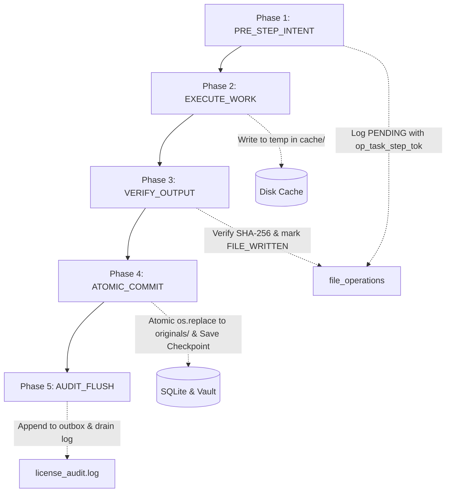

# تقرير إنجاز المعلم الرابع (Milestone 4 Completion Report)
## المهمة 3.5 — المرحلة الثانية: دمج نقاط الحفظ والتعافي من الانهيار
### (Task 3.5 — Stage 2: Milestone 4 — Checkpoint & Crash Recovery Integration)

**تاريخ الإنجاز:** 16 نوفمبر 2026  
**المشروع:** Universal AI Video Production Studio  
**نطاق التفويض:** Milestone 4 حصراً (دمج Task Checkpoints مع سجل `file_operations`، وحماية الخزينة MAM، واستعادة النظام عند الإقلاع `reconcile_recovery()`)  
**الحالة:** 🟢 **مكتمل بنسبة 100% — 105 اختبارات شاملة ناجحة (15 اختباراً جديداً لـ M4 دون أي انحدار)**

---

## 1. الملفات التي تم إنشاؤها وتعديلها (Files Created & Modified)

### أ. الملفات الجديدة المنشأة:
1. [`src/services/checkpoint_service.py`](file:///E:/AI-Projects/universal-ai-video-studio/src/services/checkpoint_service.py):
   تنفيذ بروتوكول نقاط الحفظ الخماسي المعتمد (`PRE_STEP_INTENT` -> `EXECUTE_WORK` -> `VERIFY_OUTPUT` -> `ATOMIC_COMMIT` -> `AUDIT_FLUSH`) مع التحقق الصارم من رمز التنفيذ `execution_token` وتكامل سجل `file_operations`.
2. [`src/services/recovery_service.py`](file:///E:/AI-Projects/universal-ai-video-studio/src/services/recovery_service.py):
   خدمة المصالحة والتعافي عند الإقلاع (`RecoveryService`) وتنفيذ مصفوفة الانهيار التفصيلية من القسم 5.3 في وثيقة التصميم، مع الحماية المطلقة لأصول الخزينة الأصلية وعزل الملفات اليتيمة غير المتطابقة.
3. [`tests/test_checkpoint_and_recovery.py`](file:///E:/AI-Projects/universal-ai-video-studio/tests/test_checkpoint_and_recovery.py):
   جناح اختبارات شامل يغطي 15 سيناريو واقعياً للتعافي من الانهيار عند كافة الحدود التشغيلية دون استخدام Mock.

### ب. الملفات المعدلة:
1. [`src/core/constants.py`](file:///E:/AI-Projects/universal-ai-video-studio/src/core/constants.py):
   إضافة التعداد `CheckpointStepPhase` لتمثيل المراحل الخمس لبروتوكول الحفظ.
2. [`src/core/exceptions.py`](file:///E:/AI-Projects/universal-ai-video-studio/src/core/exceptions.py):
   إضافة استثناء `AssetPathCollisionException` لحظر المساس بأي أصل أصلي عند حدوث تصادم في المسار مع بصمة مختلفة.
3. [`src/database/repositories/asset_repository.py`](file:///E:/AI-Projects/universal-ai-video-studio/src/database/repositories/asset_repository.py):
   إضافة دالة `get_by_path()` للتحقق من ملكية الأصول المسجلة في المسار المستهدف ومطابقة البصمة.
4. [`src/database/repositories/audit_repository.py`](file:///E:/AI-Projects/universal-ai-video-studio/src/database/repositories/audit_repository.py):
   تحديث دالة `lock_channel_export()` لضمان تهيئة حالة السلسلة قبل تنفيذ القفل.
5. [`src/services/asset_service.py`](file:///E:/AI-Projects/universal-ai-video-studio/src/services/asset_service.py):
   تحديث دالة `reconcile_recovery()` لربطها التلقائي بمحرك التعافي الشامل `RecoveryService` مع الحفاظ على التوافق الرجعي 100%.

---

## 2. تصميم بروتوكول نقاط الحفظ الخماسي (Checkpoint Protocol Integration)

تم تطبيق بروتوكول الحفظ المرحلي المتوافق مع قرارات التصميم المعماري (Section 5):



1. **`PRE_STEP_INTENT`:**
   - فحص الحيازة النشطة والتحقق من أن المهمة قيد التشغيل (`RUNNING`).
   - فحص نقاط الحفظ السابقة (Fast-Forward): إذا كانت الخطوة مسجلة مسبقاً، يتم تجاوز التنفيذ فوراً وإرجاع النتيجة المحفوظة ($0 cost).
   - تسجيل عملية في `file_operations` بمعرف حتمي: `op_{task_id}_{step_name}_tok{execution_token}` بحالة `PENDING`.
2. **`EXECUTE_WORK`:**
   - تنفيذ دالة العمل داخل مجلد التخزين المؤقت المعزول: `channels/{ch}/media_vault/cache/task_{id}_tok_{token}_{uuid}_{step}.tmp`.
   - الفحص الفوري لنبضات القلب (`heartbeat.is_lease_lost`)؛ وفي حال فقدان الحيازة، يتم إيقاف المعالجة فوراً وحذف الملف المؤقت.
3. **`VERIFY_OUTPUT`:**
   - التحقق من وجود الملف المؤقت وسلامة حجمه وبصمته التجزئية SHA-256.
   - الالتزام المسبق بالبصمة (Pre-Replace SHA-256 Commitment) في جدول `file_operations` مع نقل الحالة إلى `FILE_WRITTEN`.
4. **`ATOMIC_COMMIT`:**
   - التحقق من خلو المسار المستهدف من أي تصادم غير مشروع مع أصل قائم (`AssetPathCollisionException`).
   - تحديث حالة العملية إلى `DB_COMMITTED`.
   - النقل الذري من المؤقت إلى الهدف عبر `os.replace` وتحديث الحالة إلى `FILE_FINALIZED`.
   - حفظ نقطة الحفظ في `task_checkpoints` مقيدة بـ `execution_token` الصارم.
   - تحديث حالة العملية إلى `COMPLETED`.
5. **`AUDIT_FLUSH`:**
   - تسجيل حدث تدقيقي غير قابل للتعديل `TASK_STEP_CHECKPOINT` في `audit_events_outbox`.
   - تفريغ صندوق الصادر إلى ملف `license_audit.log` المحمي بـ Single-Writer Lock.

---

## 3. سلوك المصالحة والتعافي عند الإقلاع (`reconcile_recovery`)

تعتمد خدمة التعافي `RecoveryService` على جدول `file_operations` كمصدر وحيد للحقيقة (Single Source of Truth) وتطبق المصفوفة التالية عند استئناف التشغيل:

| حالة العملية المسجلة | حالة الملف الفيزيائي على القرص | التحقق من الملكية في `media_assets` | السلوك الهندسي لعملية التعافي | النتيجة والضمانة |
| :--- | :--- | :--- | :--- | :--- |
| **`PENDING`** | الملف المؤقت موجود أو غير موجود | لا يوجد هدف نهائي | حذف المؤقت، تحويل العملية إلى `FAILED` | إلغاء العملية غير المكتملة بأمان والبدء بنظافة |
| **`FILE_WRITTEN`** | الهدف موجود في `originals/` وبصمته تطابق `file_sha256` | لا يوجد تضارب، أو مسجل لنفس القناة | اعتماد الأصل في `media_assets` وحفظ Checkpoint واعتماد العملية `COMPLETED` | استئناف فوري مجاني وتفادي إعادة التوليد المكلف |
| **`FILE_WRITTEN`** | الهدف موجود في `originals/` وبصمته **لا تطابق** المسجل | الملف مسجل لأصل آخر قائم في `media_assets` | **حظر الحذف المطلق (Preserve Asset):** يمنع لمس الملف نهائياً، وتفشل العملية بـ `AssetPathCollisionException` | حماية الأصول السليمة من التدمير أو الاستبدال |
| **`FILE_WRITTEN`** | الهدف موجود في `originals/` وبصمته **لا تطابق** المسجل | الملف **غير مسجل** لأي أصل (ملف يتيم تالف) | **عزل آمن (Safe Quarantine):** نقل الملف إلى `media_vault/quarantine/` دون حذفه في مكانه، وتعليم العملية `FAILED` | الحفاظ على الأدلة وتنظيف مسار الهدف |
| **`FILE_WRITTEN`** | الهدف غير موجود، والمؤقت موجود في `cache/` وتتطابق بصمته | لا تضارب | إكمال النقل الذري `os.replace`، واعتماد الأصل و Checkpoint، وتعليم العملية `COMPLETED` | إتمام النقل بنجاح دون الحاجة لطلب المزود الخارجي |
| **`FILE_WRITTEN`** | الهدف غير موجود، والمؤقت تالف أو مفقود | لا تضارب | تنظيف المؤقت، وتعليم العملية `FAILED` | حظر اعتماد بيانات فاسدة |
| **`DB_COMMITTED`** | الهدف غير موجود والمؤقت سليم | تم الالتزام في DB | تنفيذ `os.replace` وتعليم العملية `COMPLETED` | إتمام المزامنة الفيزيائية مع قاعدة البيانات |
| **`FILE_FINALIZED`** | الهدف موجود في مساره النهائي | مسجل في DB | تعليم العملية `COMPLETED` وتنظيف أي مؤقت زائد | إنهاء الدورة بنجاح |

---

## 4. الحماية الصارمة لأصول الخزينة الأصلية (Original Media Protection)

تم تطبيق القواعد المعمارية الصارمة لحماية مجلد الخزينة:
$$\text{channels/}\{\text{channel\_id}\}\text{/media\_vault/originals/}$$
1. **منع الحذف التلقائي:** لا يمكن لأي عملية تعافي أو عامل حذف أي ملف من `originals/` لمجرد اختلاف بصمة التجزئة SHA-256.
2. **منع الاستبدال القسري:** لا يُستبدل أي أصل بناءً على نقطة حفظ فقط دون التحقق من مطابقة البصمة.
3. **مسار العزل الآمن (`quarantine/`):** أي ملف يتيم أو غير مسجل في `media_assets` يتم نقله إلى مجلد العزل:
   $$\text{media\_vault/quarantine/}\{\text{filename}\}.\text{quarantine\_}\{\text{timestamp}\}$$
   دون حذفه الفيزيائي من القرص، مع تسجيل تحذير حرج في سجل التدقيق.

---

## 5. تكامل سجل التدقيق وبوابة القفل الصارم (Audit Consistency & Export Gate)

- تخضع كل عملية استرداد أو عزل لتسجيل حدث ذري في جدول `audit_events_outbox`.
- عند حدوث أي تلاعب في سلسلة التجزئة لسجل التدقيق، تقوم دالة `lock_channel_export()` بإغلاق بوابة القناة فوراً (`is_locked = 1`).
- ترفض دالة `reconcile_recovery()` العمل على أي قناة مقفلة وتلقي استثناء `AuditIntegrityException` فوراً لمنع معالجة ملفات لقناة مشكوك في نزاهتها.

---

## 6. نتائج اختبارات الانهيار الشاملة (Crash Recovery Test Results)

تم بناء جناح اختبار مستقل ومخصص في [`tests/test_checkpoint_and_recovery.py`](file:///E:/AI-Projects/universal-ai-video-studio/tests/test_checkpoint_and_recovery.py) يغطي كافة حالات الانهيار:

| # | اسم سيناريو الاختبار | الوصف الهندسي للسيناريو | النتيجة الفعلية |
| :---: | :--- | :--- | :---: |
| 1 | `test_checkpoint_protocol_end_to_end` | تنفيذ المراحل الخمس لبروتوكول الحفظ والتحقق من التسريع الفوري (Fast-forward) | ✅ PASS |
| 2 | `test_crash_before_file_writing` | انهيار العملية في مرحلة `PENDING` قبل كتابة الملف المؤقت | ✅ PASS |
| 3 | `test_crash_after_file_writing_before_db_commit` | انهيار بعد كتابة الملف المؤقت في `cache/` واعتماده ذرياً في `originals/` | ✅ PASS |
| 4 | `test_crash_after_db_commit_before_file_finalization` | انهيار بعد الالتزام في DB وقبل إتمام النقل الفيزيائي `os.replace` | ✅ PASS |
| 5 | `test_crash_after_file_finalization_before_audit_flush` | انهيار بعد النقل الفيزيائي وقبل تفريغ التدقيق | ✅ PASS |
| 6 | `test_repeated_recovery_runs_idempotency` | التحقق من حيادية وتكرار الاسترداد (Idempotency) دون أي عمليات مكررة | ✅ PASS |
| 7 | `test_missing_files_recovery` | فقدان الملفين المؤقت والنهائي معاً أثناء الانهيار وتحويل العملية إلى `FAILED` | ✅ PASS |
| 8 | `test_unexpected_unowned_files_quarantine` | وجود ملف يتيم غير مسجل في الهدف ونقله للعزل في `quarantine/` دون حذفه | ✅ PASS |
| 9 | `test_sha256_mismatch_in_temp_file` | تلف الملف المؤقت في الكاش ومسحه بأمان مع إفشال العملية | ✅ PASS |
| 10 | `test_original_media_preservation_absolute_rule` | حظر مساس أو حذف أي أصل أصلي قائم ومسجل في الخزينة عند حدوث تصادم | ✅ PASS |
| 11 | `test_stale_execution_token_during_recovery` | منع اعتماد نقاط حفظ لعملية سابقة برمز منتهٍ بعد استرداد المهمة بواسطة Reaper | ✅ PASS |
| 12 | `test_audit_integrity_mismatch_hard_locks_recovery` | حظر الاسترداد وإلقاء `AuditIntegrityException` عند قفل بوابة التدقيق | ✅ PASS |
| 13 | `test_reconcile_interrupted_running_tasks` | استعادة المهام العالقة في `RUNNING` وإعادة جدولتها برمز جديد يعزل العمال القدامى | ✅ PASS |
| 14 | `test_checkpoint_rejection_when_heartbeat_lease_lost` | إيقاف الخطوة وحذف المؤقت عند إشعار نبض القلب بسقوط الحيازة | ✅ PASS |
| 15 | `test_crash_during_recovery_itself_resumption` | استئناف التعافي بأمان وسلاسة في حال تعطل عملية التعافي نفسها في المنتصف | ✅ PASS |

#### ملخص الفحص الشامل لكامل المشروع:
```text
Ran 105 tests in 24.895s
OK (105 passed, 0 failed, 0 errors, Zero Regressions)
```
- مهام 3.1 حتى 3.4: 49 اختباراً
- Task 3.5 M1: 12 اختباراً
- Task 3.5 M2: 14 اختباراً
- Task 3.5 M3: 15 اختباراً
- **Task 3.5 M4: 15 اختباراً**

---

## 7. المخاطر المتبقية والقيود الهندسية (Remaining Risks & Scope Boundaries)

1. **العمليات الخارجية قيد الإرسال:**
   كما هو موثق في القرارات المعمارية المعتمدة، إذا تعطل التطبيق أثناء قيام مزود AI خارجي بتوليد فيديو أو صوت، فإن محرك التعافي يرفض إعادة الإرسال التلقائي دون مفتاح Idempotency مؤكد، ويعلق المهمة في `RETRY_PENDING_APPROVAL` لحماية العميل من الفوترة المزدوجة.
2. **دمج FFmpeg:**
   معالجة الوسائط عبر FFmpeg محصورة ومجدولة في المهمة التالية (Task 3.6).

---

## 8. بوابة العبور الصارمة (Approval Gate)

توقف تام عند بوابة العبور، بانتظار مراجعة وتدقيق المستخدم المستقل (Final Verification Audit) قبل الانتقال للمعلم القادم.

