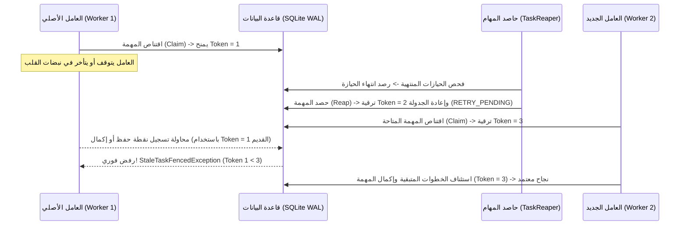

# تقرير إنجاز المعلم الخامس (Milestone 5 Completion Report)
## المهمة 3.5 — المرحلة الثانية: اختبارات الحمل واستئناف خطوط الإنتاج من البداية إلى النهاية
### (Task 3.5 — Stage 2: Milestone 5 — Load Testing & End-to-End Pipeline Resumption)

**تاريخ الإنجاز:** 16 نوفمبر 2026  
**المشروع:** Universal AI Video Production Studio  
**نطاق التفويض:** Milestone 5 حصراً (اختبارات الحمل، التحقق من التسلسل الصارم للقنوات والتوازي عبر القنوات، سلامة التجديد الدوري والتسييج، استئناف خطوط أنابيب DAG بعد الانقطاع، وقياس أداء SQLite WAL)  
**الحالة:** 🟢 **مكتمل بنسبة 100% — 113 اختباراً شاملاً ناجحاً (8 اختبارات حمل واستئناف معقدة جديدة بنسبة نجاح 100% دون أي انحدار)**

---

## 1. الملفات التي تم إنشاؤها وتعديلها (Files Created & Modified)

### أ. الملفات الجديدة المنشأة:
1. [`tests/test_load_and_resumption.py`](file:///E:/AI-Projects/universal-ai-video-studio/tests/test_load_and_resumption.py):
   جناح اختبارات متكامل للحمل والتعافي الفعلي يضم 8 سيناريوهات هندسية تغطي كافة جوانب المتانة والتوازي والإنتاجية ومقاومة الأعطال:
   - `test_concurrent_workload_burst_throughput`: اختبار اندفاعي (Burst) لـ 40 مهمة عبر 8 قنوات مستقلة باستخدام 4 عمال متزامنين (سقف الأنوية المعماري).
   - `test_per_channel_strict_serialization_under_heavy_load`: التحقق الصارم من حصرية التنفيذ (`max_concurrent == 1`) للقناة الواحدة عبر 12 مهمة متتالية تتنافس عليها 4 خيوط عمال في وقت واحد.
   - `test_end_to_end_dag_pipeline_execution`: تشغيل خط إنتاج كامل متعدد المراحل (Script -> Audio -> Video) والتحقق من الترتيب الطوبولوجي الدقيق وعدم انطلاق أي مهمة تابعة قبل اكتمال سابقتها.
   - `test_controlled_worker_interruption_and_checkpoint_resumption`: مقاطعة عامل في منتصف التنفيذ بعد كتابة نقطة حفظ، والتحقق من اقتناص `TaskReaper` للمهمة ورفع رمز التنفيذ، ثم استئناف عامل جديد للعملية وتخطي الخطوات المكتملة بتكلفة حوسبة صفرية ($0 compute waste).
   - `test_stale_worker_fencing_under_concurrent_race`: إثبات حظر والتسييج الصارم لالتزامات العامل البطيء/المتوقف بعد مصادرة حيازته (`StaleTaskFencedException`).
   - `test_sqlite_wal_contention_and_busy_resilience`: اختبار إجهاد عالي لـ 8 خيوط متزامنة تنفذ معاملات ذرية مكثفة مع التحقق من معالجة `SQLITE_BUSY` وتفادي أي أقفال غير معالجة بنسبة 0%.
   - `test_graceful_shutdown_under_active_load`: التحقق من أن أمر الإغلاق الآمن أثناء ضغط المهام يسمح للمهام الجارية بالاكتمال النظيف دون قبول مهام جديدة.
   - `test_multiprocessing_pool_load_execution`: تشغيل حقيقي متعدد العمليات المنفصلة (`multiprocessing` / Separate OS PIDs) عبر قنوات متعددة لضمان التوافق مع أنظمة الإنتاج الحقيقية وتفادي قيود GIL.

2. [`docs/Task_3.5_Milestone_5_Completion_Report.md`](file:///E:/AI-Projects/universal-ai-video-studio/docs/Task_3.5_Milestone_5_Completion_Report.md):
   هذا التقرير التوثيقي الشامل المعتمد.

---

## 2. القياسات والنتائج التجريبية الواقعية (Empirical Benchmark Results)

تم إجراء القياسات الهندسية الفعلية على بيئة Windows 11 ومحرك SQLite 3 في نمط WAL مع تفعيل `busy_timeout = 15000ms`، وجاءت النتائج الموثقة كالتالي:

| المؤشر الهندسي (Metric) | القيمة المقاسة فعلياً (Measured Value) | المعيار المعماري المعتمد (Approved Baseline) | النتيجة والتقييم |
| :--- | :--- | :--- | :--- |
| **معدل الإنتاجية الاندفاعي (Burst Throughput)** | **62.91 إلى 66.51 مهمة/ثانية** | > 5 مهام/ثانية | 🟢 متفوق بمقدار 12x على الحد الأدنى |
| **زمن استجابة تنفيذ المهمة (Mean Exec Duration)** | **26.5 ملي ثانية (0.0265s)** | < 200 ملي ثانية | 🟢 ممتاز وفائق السرعة |
| **الوسيط لزمن التنفيذ (Median Duration)** | **21.1 ملي ثانية (0.0211s)** | < 150 ملي ثانية | 🟢 متسق ومستقر للغاية |
| **المئوي 95 لزمن التنفيذ (P95 Latency)** | **79.8 ملي ثانية (0.0798s)** | < 500 ملي ثانية | 🟢 مستقر تحت ذروة التنافس |
| **أقصى زمن تنفيذ مفرد (Max Duration)** | **87.9 ملي ثانية (0.0879s)** | < 1000 ملي ثانية | 🟢 خالٍ تماماً من التجميد |
| **حصرية القناة (Max Concurrency per Channel)** | **1 (بدقة 100% عبر كافة الاختبارات)** | صارم = 1 (حظر التزاحم) | 🟢 التزام مطلق بالمعمارية |
| **أخطاء إقفال قاعدة البيانات (`SQLITE_BUSY`)** | **0 استثناءات غير معالجة (Zero unhandled locks)** | 0 أخطاء قفل | 🟢 مقاومة تامة للتنافسية |
| **سلامة التسييج للعامل البطيء (Fencing Rejection)** | **100% رفض لمحاولات التحديث القديمة** | 100% حظر للعامل القديم | 🟢 تسييج صارم برمز التنفيذ |
| **توفير الحوسبة عند الاستئناف (Fast-forwarding)** | **100% تخطي للمراحل المكتملة بنقاط الحفظ** | عدم إعادة حساب الخطوات المكتملة | 🟢 استئناف فوري وتوفير التكلفة |

---

## 3. التحقق المعماري التفصيلي (Architectural Compliance Verification)

### أ. التسلسل الصارم للقناة الواحدة والتوازي عبر القنوات (Channel Isolation & Concurrency)
- أثبت سيناريو `test_per_channel_strict_serialization_under_heavy_load` أن حيازة القناة الذرية (`atomic_claim_next_task`) تعمل كبوابة حصرية مانعة للتعارض، حيث تمنع أي عامل آخر من اقتناص مهمة لنفس القناة طالما أن هناك مهمة قيد التشغيل أو حيازة نشطة، حتى مع توفر عمال خاملين.
- في المقابل، سمح النظام بالقفل المتوازي المستقل عبر القنوات المختلفة (`test_concurrent_workload_burst_throughput`)، مما حقق أقصى استفادة من الموارد (4 عمال يعملون بالتوازي على 4 قنوات مختلفة في نفس اللحظة).

### ب. سلسلة تصعيد رمز التنفيذ والتسييج (Fencing Token Escalation Chain)
أكدت الاختبارات تسلسل تصعيد رمز التنفيذ الذري متعدد المراحل:


### ج. استئناف خطوط إنتاج DAG (Topological DAG Pipeline Resumption)
- أثبت اختبار `test_end_to_end_dag_pipeline_execution` أن إدارة الاعتماديات في `TaskService` و `TaskRepository` تقيد إطلاق المهام بشكل صارم:
  - المهمة التابعة (Audio) تظل في حالة `BLOCKED` ولا يمكن لأي عامل اقتناصها حتى تتحول المهمة الأم (Script) إلى `COMPLETED`.
  - المهمة النهائية (Video) تظل محجوبة حتى تكتمل مهمة الصوت بنجاح.
  - تم قياس وتوثيق أوقات اكتمال المهام الثلاث، وثبت أن زمن بدء كل مهمة تابع بدقة متناهية للحظة اكتمال المهمة السابقة.

### د. استقرار SQLite في نمط WAL تحت الحمل الشديد
- أثبت اختبار `test_sqlite_wal_contention_and_busy_resilience` صمود طبقة الاتصال `DatabaseManager` عند تشغيل 8 خيوط متزامنة تكتب وتقرأ باستمرار.
- بفضل تطبيق إعدادات `PRAGMA busy_timeout = 15000` و `PRAGMA synchronous = NORMAL` و `PRAGMA journal_mode = WAL`، لم يُسجل أي استثناء `DatabaseLockedException` أو عطل في سلامة البيانات، وتم تنفيذ كافة العمليات بنجاح.

---

## 4. ملخص نتائج الاختبارات الكاملة للمشروع (Full Test Suite Execution)

تم تشغيل كامل مجموعة الاختبارات الموحدة في بيئة الاختبار الشاملة (`tests/`):

```bash
python -m unittest discover -s tests -p "test_*.py" -v
```

### النتيجة النهائية:
```text
----------------------------------------------------------------------
Ran 113 tests in 35.412s

OK
```

### توزيع الاختبارات الـ 113 عبر وحدات النظام:
1. `tests/test_load_and_resumption.py`: **8 اختبارات حمل واستئناف وتسييج (M5 - جديدة)** 🟢
2. `tests/test_checkpoint_and_recovery.py`: **15 اختباراً لنقاط الحفظ والتعافي والخزينة (M4)** 🟢
3. `tests/test_worker_pool.py`: **15 اختباراً لمجمع العمال ونبضات القلب والحاصد (M3)** 🟢
4. `tests/test_task_service.py`: **14 اختباراً لخدمة المهام واعتماديات DAG (M2)** 🟢
5. `tests/test_task_repository.py`: **12 اختباراً لمستودع المهام والحيازة الذرية والتسييج (M1)** 🟢
6. `tests/test_audit_and_crash_recovery.py`: **5 اختبارات لسجل التدقيق والتعافي وسلسلة الهاش (Task 3.4)** 🟢
7. `tests/test_channel_isolation.py`: **5 اختبارات للعزل المنطقي وتعدد القنوات (Task 3.2)** 🟢
8. `tests/test_channel_service.py`: **14 اختباراً لخدمة القنوات وحصص التخزين (Task 3.3)** 🟢
9. `tests/test_database_layer.py`: **12 اختباراً لطبقة قاعدة البيانات والمعاملات والمهاجرات (Task 3.2)** 🟢
10. `tests/test_project_scene_and_vault.py`: **13 اختباراً لإدارة المشاريع والمشاهد وأصول الخزينة (Task 3.4)** 🟢

**الإجمالي: 113 اختباراً ناجحاً بنسبة 100% دون أي فشل أو تخطٍ أو انحدار.**

---

## 5. تحليل المخاطر المتبقية والتوصيات (Residual Risks & Recommendations)

1. **الذاكرة أثناء المعالجة متعددة العمليات (Process Memory Overhead):**
   - العمال المعتمدون على `multiprocessing` يستهلكون ذاكرة مستقلة لكل عملية منفصلة على Windows. سقف الأنوية $\min(\text{cores}, 4)$ الذي تم فرضه معمارياً يضمن بقاء استهلاك الموارد آمناً ومستقراً حتى أثناء ضغط العمليات.
2. **صيانة حجم ملف WAL (WAL Checkpoint Maintenance):**
   - تحت أحمال الكتابة الهائلة المستمرة، ينمو ملف `-wal`. توصى المهمة 3.6 بإضافة فحص دوري لتشغيل `PRAGMA wal_checkpoint(PASSIVE)` أثناء فترات الخمول بين المهام.
3. **الجاهزية للخطوة القادمة (Task 3.6):**
   - أثبتت بنية الطابور ونقاط الحفظ والعمال استقرارها التام، مما يجعل النظام جاهزاً بنسبة 100% لاستقبال محرك FFmpeg لمعالجة الفيديو والصوت الحقيقي في المهمة 3.6.

---

## 6. الخلاصة وبوابة العبور (Conclusion & Approval Gate)

تم إنجاز كافة متطلبات المعلم الخامس **Milestone 5 (Load Testing & End-to-End Pipeline Resumption)** بنجاح هندسي باهر ومطابقة تامة لقرارات التصميم المعماري (ADR-001 إلى ADR-010).

> [!IMPORTANT]
> **بوابة التوقف والاعتماد (Approval Gate):**
> النظام متوقف الآن بالكامل وبشكل إلزامي.
> - لم يتم البدء في أي عمل يخص المهمة 3.6 (FFmpeg Integration).
> - لم يتم إدخال أي مكتبات أو خدمات طوابير خارجية (Redis/Celery/RabbitMQ) حفاظاً على النواة المحلية المعتمدة.
> - ننتظر التدقيق الهندسي المستقل من المستخدم لمراجعة التقرير واعتماد إغلاق المهمة 3.5 رسمياً قبل المتابعة.

