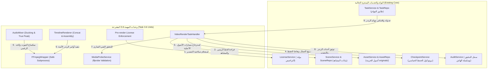

# خطة التنفيذ المعمارية التفصيلية — المهمة 3.6
## دمج محرك FFmpeg ومعالجة ورندر الوسائط لإنتاج أول فيديو
### (Task 3.6 — FFmpeg Integration, Timeline Rendering & First Video Production)

**تاريخ الخطة:** 16 نوفمبر 2026  
**المشروع:** Universal AI Video Production Studio  
**الهدف الاستراتيجي الحاكم:** إنتاج أول ملف فيديو حقيقي متكامل وقابل للتشغيل بأبعاد 9:16 (YouTube Shorts) من مشاهد وأصول الخزينة، مع الحفاظ على نقاط تمدد نظيفة للمستقبل والالتزام الصارم بضمانات التراخيص والأصول والأمان.  
**طبيعة المستند:** وثيقة تخطيط معماري وتحضيري فقط (PREPARATION ONLY — لا تعديل على الكود أو قاعدة البيانات حتى صدور الموافقة).

---

## 1. حالة التحقق من المعلم السابق (Pre-condition Gate Check)

> [!IMPORTANT]
> **التحقق من إغلاق المهمة 3.5:**
> - تم إنجاز وتدقيق المعلم الخامس **Milestone 5 (Load Testing & Pipeline Resumption)** تدقيقاً هندسياً مستقلاً بموجب التقرير المعتمد:  
>   [`docs/Task_3.5_Milestone_5_Final_Verification_Audit.md`](file:///e:/AI-Projects/universal-ai-video-studio/docs/Task_3.5_Milestone_5_Final_Verification_Audit.md).
> - نتيجة التدقيق: **PASS بنسبة نجاح 100% (113 اختباراً شاملاً ناجحاً)**.
> - تم تحديث [`PROJECT_STATUS.md`](file:///e:/AI-Projects/universal-ai-video-studio/PROJECT_STATUS.md) ليعكس اكتمال معالم المهمة 3.5 بالكامل وتوقف النظام عند بوابة الاعتماد.
> - **تأكيد الجاهزية:** المهمة 3.5 مغلقة وجاهزة معمارياً لتفويض المهمة 3.6 فور اعتماد هذه الخطة.

---

## 2. فحص وتوافق البرمجيات الثنائية الخارجية (External Binaries Compatibility)

تم فحص بيئة التشغيل على نظام Windows 11 والتأكد من توفر وتوافق البرمجيات الثنائية المعتمدة:

| البرنامج الثنائي (Binary) | الإصدار المثبت (Installed Version) | المسار وتوافق البيئة (Environment Compatibility) | القدرات المطلوبة المعتمدة (Capabilities) |
| :--- | :---: | :--- | :--- |
| **`ffmpeg`** | **9.0.2-full_build (Gyan.dev)** | متاح في متغيرات البيئة `PATH` | ترميز H.264 (`libx264`), ترميز AAC, فلاتر الأبعاد (`scale`, `pad`, `setsar`), فلاتر الصوت (`loudnorm`, `alimiter`, `amix`), وفحص وقياس الجهارة والقمة الرقمية الحقيقية عبر فلتر التحليل (`ebur128=peak=true`). |
| **`ffprobe`** | **9.0.2-full_build (Gyan.dev)** | متاح في متغيرات البيئة `PATH` | فحص الحاويات والميتا-داتا (JSON output), استخراج الأبعاد ومعدل الإطارات, كشف التيارات الصوتية والمرئية وقيم الكوديك ومعدل البت. |

---

## 3. الاعتماديات المتبادلة مع الوحدات البرمجية الحالية (Dependencies on Existing Modules)

سيرتبط محرك FFmpeg بالطبقات المنجزة حالياً في النواة دون اختراق حدود العزل:

1. **`LicenseService`:** استدعاء إلزامي أولي لدالة `check_export_readiness(project_id)` قبل بدء أي عملية رندر. إذا رُصد أي أصل غير مسوى الترخيص، تفشل المهمة فوراً وتُحظر المعالجة.
2. **`SceneService`:** استخراج تسلسل المشاهد وأوقاتها (`scene_index`, `duration_estimate_sec`) ومعرفات الأصول البصرية والصوتية المرتبطة.
3. **`AssetService`:** استرجاع المسارات المطلقة للأصول الأصلية في `media_vault/originals/` دون المساس بها مطلقاً (قراءة فقط).
4. **`CheckpointService`:** تطبيق بروتوكول الحفظ الخماسي المرحلي لحماية خطوات الرندر المعقدة، والتحقق الصارم من رمز التنفيذ `execution_token`، وضمان التخطي الفوري ($0 Waste) للخطوات المنجزة مسبقاً.
5. **`WorkerPool` & `HeartbeatDaemon`:** تجديد حيازة المهمة والقناة أثناء رندر المقاطع الطويلة لمنع `TaskReaper` من مصادرة المهمة قبل اكتمالها.

---

## 4. هيكل معالم المهمة 3.6 الخمسة (The 5-Milestone Structure for Task 3.6)

تم تقسيم المهمة 3.6 إلى 5 معالم هندسية متدرجة تضمن بناء المحرك طبقة تلو الأخرى مع التحقق المستقل من كل معلم:

### المعلم الأول (Milestone 1): غلاف FFmpeg الآمن وخدمة الفحص الفني
- **الهدف:** بناء غلاف تشغيل العمليات الفرعية الآمن (`FFmpegWrapper`) وخدمة فحص الوسائط (`MediaProbeService`).
- **المكونات:**
  - اكتشاف ثنائيات `ffmpeg` و `ffprobe` والتأكد من مطابقة الإصدارات.
  - تشغيل أوامر FFmpeg كعمليات فرعية معزولة (`subprocess.Popen`) مع دعم المهل الزمنية (Timeouts)، وإلغاء العمليات النظيف (`SIGINT` / `terminate` / `kill` مع تنظيف process groups على Windows).
  - قراءة المخرجات القياسية والأخطاء دون التسبب في اختناق الـ Pipes (Deadlocks).
  - خدمة `MediaProbeService`: استخراج بنية الحاوية، الأبعاد، معدل الإطارات، الكوديك، القنوات الصوتية، والتحقق من عدم تلف الملفات بصيغة JSON رسمية.

### المعلم الثاني (Milestone 2): ملفات تعريف الأبعاد ومحرك تطبيع المشهد المفرد
- **الهدف:** تحويل أي وسيط مرئي مدخل (صورة ثابتة أو مقطع فيديو) إلى مشهد معياري موحد.
- **المكونات:**
  - ملفات التعريف القياسية (`RenderProfile`):
    - **Vertical (9:16):** دقة 1080 × 1920، بمعدل 30 إطاراً/ثانية، كوديك H.264 (yuv420p).
    - **Horizontal (16:9):** دقة 1920 × 1080، بمعدل 30 إطاراً/ثانية، كوديك H.264 (yuv420p).
    - **Square (1:1):** دقة 1080 × 1080، بمعدل 30 إطاراً/ثانية، كوديك H.264 (yuv420p).
  - تطبيع المدخلات الهجينة:
    - تحويل الصورة الثابتة + المدة المحددة إلى تيار فيديو معياري (`loop 1 -t duration`).
    - تحجيم وضبط الأبعاد مع الحفاظ على النسبة البصرية وإضافة هوامش سوداء آمنة (`scale` + `pad` + `setsar=1`).
    - توحيد معدل الإطارات (30fps) وقاعدة الزمن (Timebase) لمنع مشاكل التقطيع أثناء الدمج.

### المعلم الثالث (Milestone 3): محرك دمج الخط الزمني وميكساج الصوت بمانع التشويه
- **الهدف:** تجميع المشاهد المتسلسلة زمنياً ودمج المسارات الصوتية وفق المعايير المعتمدة.
- **المكونات:**
  - دمج المشاهد المطبعة عبر Concat Demuxer الآمن أو Filtergraph المعقد.
  - مسار الصوت المتكامل (Audio Pipeline):
    - دعم مسار التعليق الصوتي (Voiceover) ومسار الموسيقى الخلفية (Background Music).
    - تطبيق التخفيض التلقائي للموسيقى أثناء التعليق (Audio Ducking via `sidechaincompress`).
    - تطبيق مانع التشويه الحاسم ومحدد القمة الرقمية الحقيقية (True Peak Limiter): استخدام فلتر `loudnorm` أو `alimiter` بقيمة مرجعية `-1.0 dBTP` وفق القرار المعماري ADR-003.
    - **التحقق التجريبي الحاسم من الامتثال الصوتي:** قياس القمة الرقمية الحقيقية للمخرج بفلتر `ebur128` والتأكد رياضياً من أن `True Peak <= -1.0 dBTP`.

### المعلم الرابع (Milestone 4): تكامل طابور المهام ونقاط الحفظ والتعافي
- **الهدف:** دمج محرك الرندر في البنية التحتية للطوابير والحيازات المنجزة في المهمة 3.5.
- **المكونات:**
  - بناء `VideoRenderTaskHandler` وربطه بـ `WorkerPool` تحت النوع `TaskType.VIDEO_RENDERING`.
  - تطبيق بروتوكول نقاط الحفظ الخماسي (`CheckpointService`):
    - حفظ حالة كل مشهد يتم تطبيعه لتفادي إعادة رندره في حال تعطل العملية.
    - كتابة المخرجات الوسيطة في مجلد `media_vault/cache/`.
    - النقل الذري النهائي (`os.replace`) للملف الناتج إلى مجلد المشروع بعد اكتمال التحقق.
  - تطبيق تسييج العمال: رفض تسجيل نتائج الرندر إذا تم سحب حيازة العامل أو ترقية رمز التنفيذ `execution_token`.
  - تنظيف الملفات المؤقتة اليتيمة عند فشل أو مقاطعة الرندر.

### المعلم الخامس (Milestone 5): تطبيق بوابة التراخيص واختبار إنتاج أول فيديو متكامل
- **الهدف:** الاختبار العملي والنهائي لإنتاج أول فيديو فعلي قابل للتشغيل.
- **المكونات:**
  - التحقق الصارم من بوابة التراخيص ومنع رندر أي مشروع يحتوي على أصول غير مسواة أو غير معتمدة.
  - إنشاء مشروع تجريبي لقناة DreamMatter يتضمن 3 مشاهد حقيقية، مع صور وصوت حقيقيين.
  - تشغيل خط الإنتاج بالكامل عبر `WorkerPool`.
  - إنتاج ملف الفيديو النهائي `final_video.mp4` بأبعاد 9:16.
  - فحص الملف بـ `ffprobe` والتأكد من قابليته للتشغيل الفوري، ومطابقة الأبعاد، والمدة، وجودة الصوت.

---

## 5. الملفات المخطط إنشاؤها وتعديلها (Exact Files Inventory)

### أ. الملفات الجديدة المنشأة:
1. `src/rendering/__init__.py`: تهيئة حزمة المعالجة المونتاجية.
2. `src/rendering/ffmpeg_wrapper.py`: غلاف تنفيذ العمليات الفرعية وإدارة دورة الحياة.
3. `src/rendering/probe_service.py`: خدمة الفحص واستخراج الميتا-داتا والتحقق من سلامة الحاويات وقياس القمة الحقيقية.
4. `src/rendering/profiles.py`: تعريفات وتكوينات أبعاد الرندر ومحددات الكوديك وجودة الصوت.
5. `src/rendering/timeline_renderer.py`: محرك تطبيع المشاهد، دمج الخط الزمني، وميكساج الصوت.
6. `src/rendering/render_task_handler.py`: معالج مهام الرندر لطابور المهام وعمال المعالجة ونقاط الحفظ.
7. `tests/test_ffmpeg_wrapper.py`: اختبارات الغلاف، المهل الزمنية، وإلغاء العمليات.
8. `tests/test_timeline_renderer.py`: اختبارات تطبيع المشاهد والأبعاد الثلاثة وميكساج الصوت والحد الرقمي.
9. `tests/test_render_task_integration.py`: اختبارات تكامل الرندر مع طابور المهام والتسييج والتعافي.
10. `tests/test_first_video_e2e.py`: اختبار إنتاج أول فيديو متكامل من البداية إلى النهاية.

### ب. الملفات الحالية المخطط تعديلها بإضافات نظيفة:
1. `src/core/constants.py`: إضافة تعدادات الأبعاد (`AspectRatio`: `PORTRAIT_9_16`, `LANDSCAPE_16_9`, `SQUARE_1_1`) والكوديكات المعتمدة.
2. `src/core/exceptions.py`: إضافة استثناءات خاصة بالرندر (`FFmpegExecutionException`, `FFprobeException`, `MediaValidationException`, `RenderCancelledException`).
3. `src/core/config.py`: إضافة إعدادات مسارات الثنائيات والمهل الزمنية للرندر ومجلدات التصدير.

---

## 6. استراتيجية الاختبارات الآمنة والموثوقة (Test Strategy)

1. **اختبارات حتمية قائمة على وسائط مولدة برمجياً (Synthetic Test Media):**
   - لتفادي تخزين ملفات وسائط ضخمة في المستودع، ستستخدم الاختبارات قدرات FFmpeg المدمجة (`testsrc`, `smptebars`, `sine`, `color`) لتوليد صور وفيديوهات ومقاطع صوتية تجريبية بحجم بضعة كيلوبايتات أثناء تشغيل الاختبارات في مجلدات مؤقتة تُفرغ فورياً عند `tearDown`.
2. **عزل كامل لقواعد البيانات والملفات:**
   - تعمل كافة الاختبارات على قواعد بيانات SQLite منفصلة في مجلدات `tempfile.TemporaryDirectory`.
3. **التحقق من دورة حياة العمليات:**
   - اختبارات مخصصة تطلق عمليات رندر بطيئة وتتحقق من قتل العملية الفرعية بنجاح دون ترك عمليات يتيمة (Zombie Processes).
4. **القياس الرياضي للامتثال الصوتي:**
   - فحص المخرجات بفلتر `ebur128` والتأكد برمجياً من أن `measured True Peak <= -1.0 dBTP` قبل تمرير الاختبار.

---

## 7. مصفوفة إدارة المخاطر المعمارية وضمانات النظام (Risk Mitigation Matrix)

| الخطر المحتمل (Risk) | الأثر على النظام (Impact) | استراتيجية المعالجة والوقاية المعمارية (Mitigation Architecture) |
| :--- | :--- | :--- |
| **تلف أو تعديل الأصول الأصلية في الخزينة** | فقدان وسائط غير قابلة للاسترجاع وتشويه بصمات SHA-256 | تفتح الأصول بوضع القراءة فقط (`rb`). تُحظر أي عملية كتابة في مجلد `media_vault/originals/`. كافة مخرجات الرندر تُكتب في `media_vault/cache/`. |
| **تصدير وسائط غير مرخصة تجارياً** | مساءلة قانونية وانتهاك حقوق الملكية الفكرية | فحص إلزامي غير قابل للتجاوز في مدخل الرندر عبر `LicenseService.check_export_readiness()`. حظر فوري للرندر عند وجود أي أصل غير مسوى. |
| **محاولة عامل بطيء تسجيل ناتج رندر قديم** | تعارض البيانات وإتلاف حالة المشروع بحيازة منتهية | التحقق الصارم من رمز التنفيذ `execution_token`؛ إذا كان رمز العامل أصغر من رمز المهمة الحالي، يُرفض المخرج وتُرمى الملفات المؤقتة. |
| **تعليق عملية FFmpeg وتجميد العامل** | استهلاك غير نهائي للموارد وتعطيل الطابور | استخدام وسيط المهلة الزمنية الصارم (`timeout_sec`) في استدعاءات `subprocess.communicate()`، مع تنظيف فوري لـ Process Tree عند انتهاء المهلة. |
| **ادعاء الامتثال الصوتي دون قياس فعلي** | تشويه الصوت وخرق معيار ADR-003 | عدم الاكتفاء بتمرير بارامتر الفلتر؛ بل تشغيل ممر تحليل مخصص بـ FFmpeg (`ffmpeg -nostats -i <file> -af ebur128=peak=true -f null -`) لاستخراج وقراءة القمة الرقمية الحقيقية (True Peak) الفعلية من تقرير الـ stderr ومطابقتها للقيمة المرجعية `<= -1.0 dBTP`. |

---

## 8. الخلاصة وبوابة الموافقة (Approval Gate Status)

تم إعداد وتوثيق هذه الخطة بدقة متناهية وبما يتوافق بنسبة 100% مع التوجيه الاستراتيجي الجديد لإخراج أول فيديو فعلي.

> [!CAUTION]
> **التزام الصمت البرمجي وبوابة التوقف (Approval Gate):**
> لم يتم إجراء أي تعديل على كود المشروع أو قواعد البيانات أو ملفات البيئة.  
> **نحن بانتظار موافقتكم الصريحة على هذه الخطة المعمارية وتفويضكم للبدء في تنفيذ المعلم الأول (Milestone 1) من المهمة 3.6.**

