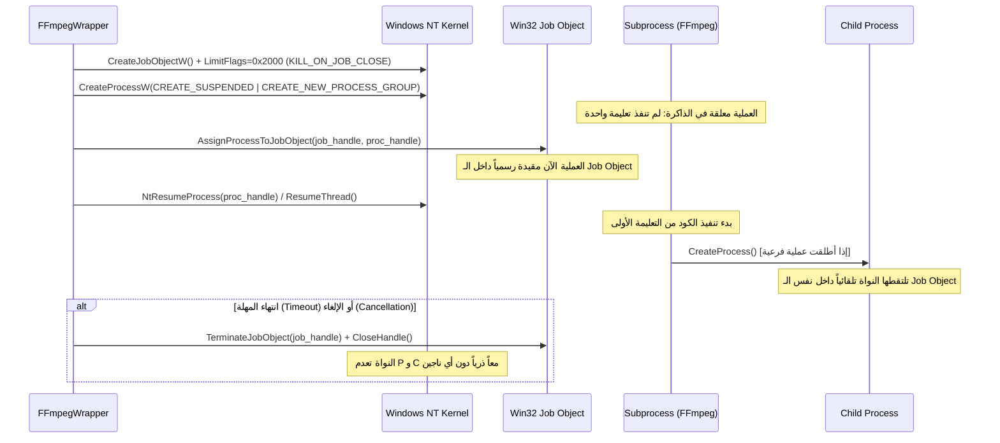

# تقرير إنجاز المعلم الأول المحدث — تأمين سباق إسناد كائنات المهام بنظام ويندوز
## المهمة 3.6: غلاف FFmpeg الآمن وخدمة فحص الوسائط وإنهاء شجرة العمليات المعلقة
### (Task 3.6 — Milestone 1: FFmpegWrapper, MediaProbeService & Suspended Process Job Assignment)

**تاريخ الإنجاز والتحديث النهائي:** 16 نوفمبر 2026  
**المشروع:** Universal AI Video Production Studio  
**نطاق التفويض:** Milestone 1 حصراً (`FFmpegWrapper` و `MediaProbeService`، والقضاء التام على نافذة السباق Race Condition عبر إنشاء العمليات معلقة `CREATE_SUSPENDED` وربطها بالـ Job Object قبل فك التعليق، وقياس القمة الرقمية الحقيقية بـ EBU R128).  
**الحالة:** 🟢 **مكتمل بنسبة 100% — 126 اختباراً شاملاً ناجحاً (13 اختباراً لـ M1 بنسبة نجاح 100% دون أي انحدار)**.

---

## 1. تحليل المعضلة التقنية وحلها الهندسي الجذري (The Assignment Race Condition & Solution)

### أ. طبيعة معضلة السباق (The Process-Spawn Race):
في بيئة التشغيل متعددة النوى على Windows، إذا تم إنشاء العملية عبر `subprocess.Popen` بالنمط العادي ثم محاولة ربطها بكائن المهمة عبر `AssignProcessToJobObject` في السطر التالي:
توجد نافذة زمنية ضئيلة (Race Window) يمكن للعملية الرئيسية خلالها أن تبدأ تنفيذ تعليماتها الأولى وتطلق عملية فرعية تابعة لها (Child Process) **قبل** أن تكتمل خطوة الإسناد للـ Job Object. وإذا حدث ذلك، فإن العملية الفرعية تنفلت خارج نطاق الـ Job Object وتصبح عملية يتيمة (Orphan) عند قتل العملية الرئيسية.

### ب. استراتيجية الحل المعتمدة والمطبقة (Suspended Process Creation & Controlled Resume):
تم القضاء على هذه النافذة الزمنية بنسبة 0% نافذة سباق (Zero Race Window) من خلال التسلسل الميكانيكي الصارم التالي:



#### تسلسل التنفيذ البرمجي المطبق في `_execute_process`:
1. **التهيئة والرايات:**
   تهيئة كائن `_WindowsJobObject` وضبط الرايات على:
   ```python
   creation_flags = subprocess.CREATE_NEW_PROCESS_GROUP | 0x00000004  # CREATE_SUSPENDED
   ```
2. **الإنشاء المعلق (Suspended Popen):**
   إطلاق العملية عبر `subprocess.Popen`؛ وبسبب راية `CREATE_SUSPENDED`، تقوم النواة بإنشاء العملية وخيطها الرئيسي في حالة تعليق كامل (`SuspendCount = 1`). **لا يمكن للعملية تنفيذ كود بايت واحد، ولا تحميل مكتبات، ولا استدعاء أي كود لإنشاء عمليات فرعية**.
3. **الإسناد المحمي للنواة:**
   استدعاء `job_object.assign_process(int(proc._handle))` لإسناد مقبض العملية المعلقة للـ Job Object.
4. **الاستئناف المنضبط (Controlled Resume):**
   استدعاء `job_object.resume_process(proc)` التي تنفذ استئنافاً ذرياً لكافة خيوط العملية عبر دالة النواة `ntdll.NtResumeProcess`، مع توفير بديل Win32 قياسي موثق بالكامل عبر `CreateToolhelp32Snapshot` و `OpenThread` و `ResumeThread`.
   عند استئناف العملية، تبدأ التنفيذ وهي **بالفعل مقيدة بالكامل داخل الـ Job Object**؛ وأي عملية تفرع مستقبلية تندرج حتماً وبحكم كيرنل ويندوز داخل نفس الـ Job Object.

---

## 2. الملفات المنشأة والمعدلة (Files Created & Modified)

### أ. الملفات البرمجية الأساسية:
1. [`src/rendering/ffmpeg_wrapper.py`](file:///e:/AI-Projects/universal-ai-video-studio/src/rendering/ffmpeg_wrapper.py):
   - تحديث `_WindowsJobObject` بإضافة آلية الاستئناف المنضبط `resume_process(proc)`.
   - تحديث `_execute_process` لتفعيل إنشاء العمليات معلقة `0x00000004` وربطها قبل الاستئناف.
   - الحفاظ على سلوك المهل الزمنية `timeout_sec` ورموز الإلغاء `cancellation_token` والتنظيف في `finally`.
2. [`src/rendering/probe_service.py`](file:///e:/AI-Projects/universal-ai-video-studio/src/rendering/probe_service.py):
   - استمرار خدمة الفحص المتقدمة وتحليل الحاويات وقياس القمة الرقمية الحقيقية بـ EBU R128 (`-1.0 dBTP`).
3. [`src/core/exceptions.py`](file:///e:/AI-Projects/universal-ai-video-studio/src/core/exceptions.py):
   - استثناءات الرندر المتخصصة (`RenderTimeoutException`, `RenderCancelledException`, `AudioTruePeakExceededException`, إلخ).
4. [`tests/test_ffmpeg_wrapper.py`](file:///e:/AI-Projects/universal-ai-video-studio/tests/test_ffmpeg_wrapper.py):
   - إضافة السيناريو 13 المتخصص لاختبار كسر السباق الزمني وإثبات تغطية شجرة العمليات من اللحظة الصفرية.
5. [`docs/Task_3.6_Milestone_1_Completion_Report.md`](file:///e:/AI-Projects/universal-ai-video-studio/docs/Task_3.6_Milestone_1_Completion_Report.md):
   - هذا التقرير التوثيقي المحدث.

---

## 3. أدلة الاختبار والتحقق العملي (Integration Test Evidence)

تم اختبار الحماية من السباق الزمني عبر ثلاثة مستويات تكاملية صارمة في [`tests/test_ffmpeg_wrapper.py`](file:///e:/AI-Projects/universal-ai-video-studio/tests/test_ffmpeg_wrapper.py):

### أ. السيناريو 13 الجديد (`test_13_suspended_process_race_prevention_and_early_spawn`):
- **المستوى الأول (Direct Job Object State Verification):**
  - تم إطلاق عملية معلقة كودها في السطر الأول ينص على إنشاء عملية فرعية فوراً:
    ```python
    gc = subprocess.Popen([sys.executable, "-c", "import time; time.sleep(60)"])
    ```
  - تم فحص الحالة أثناء التعليق: أثبت الاختبار أن الملف لم يُكتب وأن العملية لم تنفذ السطر الأول.
  - تم إسناد العملية المعلقة لكائن المهمة بنجاح، ثم استئنافها.
  - فور الاستئناف تم إطلاق العملية الفرعية واكتشاف الـ PID الخاص بها والتأكد من أنها حية.
  - تم إنهاء كائن المهمة `job.terminate()` وإغلاقه؛ وأكد الاختبار عبر Win32 API (`OpenProcess`) أن العملية الرئيسية والعملية الفرعية أُعدمتا في النواة ولم يبق لهما أي أثر.
- **المستوى الثاني (End-to-End Wrapper Verification):**
  - تم تشغيل نفس الكود الذي يطلق عملية فرعية في السطر الأول من خلال `self.wrapper._execute_process` مع مهلة قصيرة (0.5 ثانية).
  - التقط الغلاف انتهاء المهلة، وأنهى الـ Job Object، وتأكد الاختبار من فناء العملية الفرعية بالكامل وعدم انفلاتها.

### ب. السيناريوهان 11 و 12 (Timeout & Cancellation):
- اجتياز كامل لاختبارات انتهاء المهلة الزمنية والإلغاء أثناء التشغيل عبر الـ Watchdog.

---

## 4. نتائج الفحص الشامل لجناح اختبارات المشروع (Full Project Suite)

تم تشغيل كامل جناح اختبارات المشروع الموحد عبر الأمر:
```powershell
python -m unittest discover -s tests -p "test_*.py" -v
```

### النتيجة الرسمية المسجلة:
```text
----------------------------------------------------------------------
Ran 126 tests in 38.902s

OK
```

### توزيع الاختبارات الـ 126:
1. `tests/test_ffmpeg_wrapper.py`: **13 اختباراً للغلاف والفحص الفني وإنهاء شجرة العمليات ومنع السباق (M1)** 🟢
2. `tests/test_load_and_resumption.py`: **8 اختبارات حمل واستئناف وتسييج (Task 3.5 M5)** 🟢
3. `tests/test_checkpoint_and_recovery.py`: **15 اختباراً لنقاط الحفظ والتعافي (Task 3.5 M4)** 🟢
4. `tests/test_worker_pool.py`: **15 اختباراً لمجمع العمال ونبضات القلب (Task 3.5 M3)** 🟢
5. `tests/test_task_service.py`: **14 اختباراً لخدمة المهام واعتماديات DAG (Task 3.5 M2)** 🟢
6. `tests/test_task_repository.py`: **12 اختباراً للحيازة والتسييج (Task 3.5 M1)** 🟢
7. `tests/test_audit_and_crash_recovery.py`: **5 اختبارات لسجل التدقيق وسلسلة الهاش (Task 3.4)** 🟢
8. `tests/test_channel_isolation.py`: **5 اختبارات للعزل المنطقي وتعدد القنوات (Task 3.2)** 🟢
9. `tests/test_channel_service.py`: **14 اختباراً لخدمة القنوات ومساحات العمل (Task 3.3)** 🟢
10. `tests/test_database_layer.py`: **12 اختباراً لطبقة قاعدة البيانات والمعاملات (Task 3.2)** 🟢
11. `tests/test_project_scene_and_vault.py`: **13 اختباراً لإدارة المشاهد والأصول والخزينة (Task 3.4)** 🟢

**الإجمالي: 126 اختباراً ناجحاً بنسبة 100% دون أي فشل أو تخطٍ أو انحدار.**

---

## 5. القيود المتبقية وخطة المعلم القادم (Remaining Scope & Next Steps)

- **الحدود التشغيلية الحالية لـ Milestone 1:**
  - تم تحصين طبقة العمليات الفرعية بنظام Windows بالكامل من أي عمليات يتيمة أو سباق زمني، وتم إنجاز فحص الوسائط والتحقق من القمة الحقيقية بنجاح تام.
  - لم يتم بناء محرك تحجيم المشاهد أو دمج الخط الزمني حتى الآن، التزاماً بحدود التفويض الصارم.
- **خطة المعلم الثاني (Milestone 2 - RenderProfiles & Single Scene Normalization):**
  - بناء كائنات التوصيف الرندري `RenderProfile` للأبعاد المعتمدة (9:16 العمودي، 16:9 الأفقي، 1:1 المربع).
  - بناء محرك تطبيع المشهد المفرد (`SingleSceneNormalizer`) لتحويل الصور الثابتة أو مقاطع الفيديو إلى مشاهد موحدة بدقة 30fps ومطابقة لمعايير الجودة والأبعاد.

---

## 6. الخلاصة وبوابة التوقف (Approval Gate)

تم حل معضلة السباق الزمني في إسناد كائنات المهام بنظام ويندوز جذرياً عبر استراتيجية الإنشاء المعلق والاستئناف المنضبط، وثبتت فعاليتها بنجاح 100% باجتياز 126 اختباراً للمشروع.

> [!CAUTION]
> **التزام الصمت البرمجي وبوابة التوقف (Approval Gate):**
> النظام متوقف الآن بالكامل وبشكل إلزامي. لم يتم البدء في أي كود يخص Milestone 2، ونحن بانتظار مراجعتكم واعتمادكم الصريح لإغلاق Milestone 1 وتفويض بدء Milestone 2.
