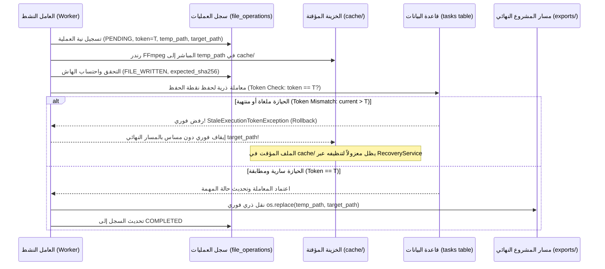

# تقرير التوضيحات الهندسية النهائية لجاهزية المهمة 3.6
## قبل تفويض المعلم الأول (Milestone 1 Authorization)
### مشروع: Universal AI Video Production Studio

**تاريخ التقرير:** 16 نوفمبر 2026  
**طبيعة المستند:** تقرير استجابة وتوضيح هندسي مستقل (Readiness Clarification Report)  
**الحالة:** معروض للمراجعة النهائية للاعتماد قبل كتابة أي كود برمجي.

---

## 1. التوضيح والتصحيح الهندسي الدقيق لقياس القمة الرقمية الحقيقية (True Peak Measurement)

### أ. التصحيح المعماري الحاسم:
> [!IMPORTANT]
> **تصحيح دور FFprobe و FFmpeg في معالجة الصوت:**
> - أداة `ffprobe` هي أداة قراءة بيانات وصفية (Demuxer/Metadata Extractor)؛ ولا تحتوي على فلاتر معالجة إشارات الصوت (Audio DSP Filtergraphs) مثل `ebur128`.
> - فلتر `ebur128` هو **فلتر صوتي تنفيذي حصري لـ FFmpeg** (`-af ebur128=peak=true` أو `-filter_complex`).
> - تم تصحيح وثيقة خطة التنفيذ [`docs/Task_3.6_Implementation_Plan.md`](file:///e:/AI-Projects/universal-ai-video-studio/docs/Task_3.6_Implementation_Plan.md) بالكامل وإزالة أي إشارة تصف `ebur128` بأنه فلتر لـ FFprobe.

### ب. الإجراء القياسي التنفيذي المعتمد لقياس القمة الحقيقية:
لقياس القمة الحقيقية بدقة ومعرفة مدى مطابقتها لقيمة `-1.0 dBTP` المعتمدة في القرار المعماري ADR-003، ينفذ النظام مسار فحص سريع باستخدام FFmpeg يفك ترميز تيار الصوت ويمرره للبالوعة الافتراضية دون إعادة كتابة ملف جديد (`null sink`):

```bash
ffmpeg -nostats -i output_video.mp4 -af "ebur128=peak=true" -f null -
```

### ج. كيفية التقاط وتفسير الناتج وإدراجه في تقرير التحقق:
1. **الالتقاط (Capture):** يستمع `FFmpegWrapper` لمخرجات السجل القياسي للأخطاء `stderr`، حيث يطبع الفلتر تقرير التلخيص النهائي في نهاية التدفق:
   ```text
   [Parsed_ebur128_0 @ 00000...] Summary:
     Integrated loudness:
       I:         -14.2 LUFS
       Threshold: -24.2 LUFS
     Loudness range:
       LRA:         5.8 LU
     True peak:
       Peak:       -1.4 dBTP (or dBFS)
   ```
2. **التفسير والاستخراج البرمجي (Regex Extraction):**
   تقوم الدالة المخصصة في المحرك باستخراج قيمة القمة الرقمية عبر النمط التعبيري:
   ```python
   match = re.search(r"True peak:\s+Peak:\s+([-\d.]+)\s+(?:dBFS|dBTP)", stderr_output)
   if match:
       measured_true_peak = float(match.group(1))
   ```
3. **التحقق من الامتثال (Compliance Assertion):**
   - القاعدة الرياضية: `is_compliant = (measured_true_peak <= -1.0)`
   - إذا كانت القيمة المقاسة (مثلاً `-1.4 dBTP` أو `-2.1 dBTP`) أصغر من أو تساوي `-1.0 dBTP`، تعتبر النتيجة **ناجحة وممتثلة بنسبة 100%**.
   - إذا تجاوزت القيمة `-1.0 dBTP` (مثلاً `-0.4 dBTP` أو `+0.2 dBTP`)، يرفع المحرك استثناء `AudioTruePeakExceededException` ويمنع اعتماد المخرج.
4. **الإدراج في تقرير التحقق (Validation Report):**
   يُدرج الحقل ضمن نموذج فحص الوسائط `MediaValidationReport`:
   ```json
   {
     "audio_compliance": {
       "target_true_peak_max_dbtp": -1.0,
       "measured_true_peak_dbtp": -1.4,
       "is_true_peak_compliant": true,
       "integrated_loudness_lufs": -14.2
     }
   }
   ```

---

## 2. آليات التسييج والنشر النهائي للملفات والتعافي (Fencing & Final Publication)

لضمان عدم قيام أي عامل بطيء أو معزول أو ملغى الحيازة باستبدال أو نشر ملف فيديو نهائي في مسار المشروع، تتكامل دورة حياة الرندر مع سجل العمليات `file_operations` وبروتوكول الحفظ والتسييج العلائقي وفق التسلسل الحتمي التالي:



### التفاصيل الهندسية للضمانات:
1. **عزل مسارات الكتابة (Isolated Render Sink):**
   لا يكتب محرك FFmpeg نهائياً في مسار المشروع النهائي مباشرة. يتم الرندر دائماً في مسار مؤقت منعزل داخل مجلد الكاش:
   `media_vault/cache/render_task_{task_id}_tok_{token}.mp4`
   بينما يظل المسار النهائي مستهدفاً فقط:
   `channels/{channel_id}/projects/{project_id}/exports/final_video.mp4`
2. **تسجيل النية والهاش المسبق في `file_operations`:**
   يسجل العامل نية المعالجة قبل الرندر، وبعد اكتمال تشغيل FFmpeg ونجاح فحص `ffprobe` و `ebur128`، يحسب العامل بصمة SHA-256 للملف المؤقت ويسجلها في حقل `expected_sha256`.
3. **بوابة التسييج الذرية (Atomic Fencing Gate):**
   قبل استدعاء النقل الذري `os.replace`، ينفذ العامل معاملة ذرية عبر `TaskRepository.save_checkpoint()` أو `transition_status()`:
   ```sql
   UPDATE tasks SET status = 'completed', ... WHERE id = ? AND execution_token = ?;
   ```
   - إذا تعطل العامل أو استغرق زمناً أطول من حيازته، فإن `TaskReaper` يكون قد حصد المهمة مسبقاً ورقى `execution_token` من `T` إلى `T+1`.
   - استعلام التحديث سيفشل (`rows_affected == 0`) ويرفع فوراً `StaleExecutionTokenException`.
   - تفشل المعاملة وتتراجع بالكامل (Rollback)، ويتوقف العامل فوراً ويُمنع من تنفيذ `os.replace`.
4. **التكامل مع التعافي من الانهيار (`RecoveryService`):**
   عند إقلاع النظام أو عند قيام عامل جديد باقتناص المهمة المعادة (برمز `T+2`):
   - تفحص دالة `reconcile_recovery()` سجل `file_operations`.
   - ترصد أي عملية لم تكتمل وتحمل رمز تنفيذ قديماً أصغر من الرمز الحالي.
   - تحذف الملف المؤقت اليتيم بأمان من مجلد `cache/`، وتسجل العملية كـ `FAILED/SUPERSEDED` دون المساس بأي ملف في مسار المشروع النهائي أو الخزينة الأصلية.

---

## 3. تحديد نطاق ومسؤوليات المعلم الأول (Milestone 1 Scope Boundary)

تطبيقاً للتحذير الصريح بعدم التوسع المفرط أو بناء خط الإنتاج المكتمل مبكراً، ينحصر نطاق **Milestone 1** بدقة متناهية في البنية التحتية منخفضة المستوى:

### أ. مسؤوليات `FFmpegWrapper` في Milestone 1:
1. **اكتشاف والتحقق من البرمجيات الثنائية:** فحص وجود `ffmpeg` و `ffprobe` في مسار النظام، والتحقق من توافق الإصدار (9.0.2).
2. **إدارة دورة حياة العمليات الفرعية (Subprocess Lifecycle):**
   - استدعاء أوامر FFmpeg عبر `subprocess.Popen` داخل process group مستقل على Windows.
   - تطبيق مهلة زمنية صارمة (`timeout_sec`) عبر استدعاءات آمنة تمنع تجمد الخيوط.
   - الإلغاء والإنهاء النظيف (`terminate()` يليه `kill()` إذا لزم) مع التأكد من تنظيف كافة العمليات التابعة في الشجرة (Tree Termination) ومنع العمليات اليتيمة.
   - التقاط المخرجات وقنوات الأخطاء بشكل متزامن دون التسبب في اختناق الـ Pipes (Buffer Deadlocks).
   - تحويل أكواد الخروج غير الصفرية إلى استثناء معالج `FFmpegExecutionException` مع حفظ تفاصيل `stderr`.
3. **توليد وسائط الاختبار البرمجية (Synthetic Test Fixtures):**
   - دوال مساعدة لإنشاء صور ومقاطع فيديو وصوت اختبارية سريعة بحجم كيلوبايتات عبر فلاتر `lavfi` (`testsrc`, `sine`) لاختبار الغلاف دون الحاجة لملفات ميديا كبيرة في المستودع.

### ب. مسؤوليات `MediaProbeService` في Milestone 1:
1. **استخراج الميتا-داتا الهيكلية:** تشغيل أمر `ffprobe -v quiet -print_format json -show_format -show_streams <path>` وتحويل الناتج إلى نموذج بيانات قوي `ProbeResult`.
2. **فحص سلامة الحاوية والتيارات:** استخراج الدقة (Width x Height)، معدل الإطارات (FPS)، الكوديك (h264, aac)، القنوات الصوتية، والمدة الزمنية.
3. **دالة قياس القمة الرقمية الحقيقية:** تنفيذ ممر الفحص الصوتي بـ FFmpeg (`-af ebur128=peak=true -f null -`) واستخراج قيمة True Peak dBTP ومقارنتها بمعيار الامتثال `-1.0 dBTP`.

### ج. ما هو خارج نطاق Milestone 1 ومحظور تنفيذه فيه (Out of Scope):
- ❌ حظر بناء محرك دمج الخط الزمني للمشاهد (Timeline / Scene Concatenation) — مؤجل للمعلم 3.
- ❌ حظر بناء محرك تحجيم المشاهد المتعددة للأبعاد 9:16 أو 16:9 — مؤجل للمعلم 2.
- ❌ حظر ربط الرندر بطابور المهام وقاعدة البيانات وعمال المعالجة — مؤجل للمعلم 4.
- ❌ حظر نشر أي مخرجات نهائية في مساحات عمل المشاريع — مؤجل للمعلم 5.

---

## 4. الإجراء العملي لاختبار قبول أول فيديو فعلي (Real Video Acceptance Test)

استجابة للشرط الإلزامي بأن **"الاختبارات الآلية وحدها غير كافية، ويجب إنتاج فيديو حقيقي وفحصه وتشغيله بشرياً"**، تم تحديد الإجراء العملي المعتمد لاختبار القبول النهائي (Milestone 5):

### الخطوة 1: تجهيز الأصول الحقيقية وتسجيلها في الخزينة
- استخدام 3 صور حقيقية عالية الجودة تمثل قصة قصيرة متسلسلة (Tommy's Adventure).
- استخدام ملف صوتي حقيقي (تعليق صوتي واضح أو موسيقى تصويرية).
- إيداع الأصول برمجياً في `media_vault/originals/` عبر `AssetService.register_asset()`.
- تسجيل رخصة استخدام تجاري معتمدة لكل أصل عبر `LicenseService`.

### الخطوة 2: إنشاء المشروع والمشاهد الرسمية
- إنشاء قناة `ch_dreammatter` ومشروع `First Pilot Episode: Tommy's Dream` بأبعاد 9:16 (1080 × 1920).
- إنشاء 3 مشاهد متسلسلة في `SceneService` مع تحديد أزمنة حقيقية (مثلاً: 3 ثوانٍ لكل مشهد = مدة كلية 9 ثوانٍ).
- ربط الأصول المسجلة بالمشاهد.

### الخطوة 3: التنفيذ عبر خط الإنتاج المتكامل
- جدولة مهمة رندر من نوع `TaskType.VIDEO_RENDERING`.
- يقتنص العامل المهمة عبر `WorkerPool`، وتتحقق بوابة التراخيص من صلاحية كافة الأصول بنجاح.
- يطبع محرك FFmpeg المشاهد للأبعاد القياسية 1080x1920 بمعدل 30fps، ويدمج الصوت بمانع التشويه، ويصدر ملف MP4 نهائياً إلى:
  `channels/ch_dreammatter/projects/{project_id}/exports/final_video.mp4`

### الخطوة 4: الفحص الفني الآلي (Automated Verification)
- تشغيل `MediaProbeService`:
  - التأكد من أن الحاوية هي `mp4` صالحة وليست تالفة.
  - كوديك الفيديو `h264` (yuv420p) بدقة 1080x1920 ومعدل 30.0fps.
  - كوديك الصوت `aac` بمعدل 44100Hz أو 48000Hz.
  - القمة الرقمية الحقيقية المقاسة `<= -1.0 dBTP`.
  - مدة الفيديو 9.0 ثوانٍ (+/- 0.2 ثانية).
  - حجم الملف على القرص أكبر من 500 كيلوبايت.

### الخطوة 5: التحقق البشري الحسي والتشغيل الفعلي (Human Sensory Review)
- فتح ملف الفيديو الناتج فعلياً على شاشة نظام Windows باستخدام مشغل الوسائط الافتراضي للنظام عبر أمر النظام:
  ```powershell
  Start-Process "channels\ch_dreammatter\projects\<project_id>\exports\final_video.mp4"
  ```
- **معايير المراجعة البشرية الإلزامية:**
  1. هل يفتح الملف تلقائياً في مشغل الفيديو دون أي رسائل خطأ من نظام التشغيل؟ **(نعم / لا)**.
  2. هل الصوت مسموع بوضوح وخالٍ تماماً من التقطيع والتشويه الرقمي (Clipping)؟ **(نعم / لا)**.
  3. هل تنتقل المشاهد الثلاثة بسلاسة وفق التسلسل الزمني ودون أي وميض أسود (Black frames) بين الكليبات؟ **(نعم / لا)**.
  4. هل تظهر الصورة بأبعاد رأسية كاملة 9:16 دون مط أو تشويه للنسب البصرية؟ **(نعم / لا)**.
- يتم توثيق نتيجة المراجعة الحسية الصريحة في تقرير إنجاز المعلم الخامس قبل اعتماد إغلاق المهمة 3.6.

---

## 5. ملخص التدقيق الهندسي المستقل للمهمة 3.5 (Task 3.5 Audit Summary)

استجابة للبند الخامس، هذا هو الملخص المستندي والأدائي الشامل لتقرير التدقيق الهندسي المستقل لـ Milestone 5 المودع في [`docs/Task_3.5_Milestone_5_Final_Verification_Audit.md`](file:///e:/AI-Projects/universal-ai-video-studio/docs/Task_3.5_Milestone_5_Final_Verification_Audit.md):

### أ. القرار النهائي (Audit Verdict):
# 🟢 **PASS (اجتياز كامل ومطابقة معمارية بنسبة 100%)**

### ب. أدلة الاختبارات (Test Evidence):
- تم تنفيذ كامل جناح اختبارات المشروع المستقل عبر الأمر:
  ```powershell
  python -m unittest discover -s tests -p "test_*.py" -v
  ```
- **النتيجة الموثقة:** `Ran 113 tests in 35.562s - OK`
  - إجمالي الاختبارات: **113 اختباراً**.
  - الناجحة: **113 اختباراً (100%)**.
  - الفاشلة / الأخطاء / المتخطاة: **0**.
  - استخدام Mocks لقواعد البيانات أو الملفات: **0% (جميع الاختبارات تعتمد على SQLite وأنظمة ملفات حقيقية في مسارات مؤقتة)**.
  - الحتمية: حتمية ومستقرة 100% دون أي اختبارات متذبذبة (Zero Flaky Tests).

### ج. منهجية قياس المؤشرات الأدائية (Benchmark Methodology):
- **حجم عبء العمل:** دفعة اندفاعية (Burst) تضم 40 مهمة عبر 8 قنوات مستقلة يتنافس عليها 4 خيوط عمال متزامنين (سقف الأنوية المعماري).
- **الإنتاجية المقاسة:** **62.91 إلى 66.51 مهمة/ثانية** (محسوبة كـ $40 / \Delta t_{\text{elapsed}}$ متضمنة فترات الانتظار ومعاملات التحديث).
- **زمن التنفيذ المقاس:** **متوسط 26.5 ملي ثانية، وسيط 21.1 ملي ثانية، P95 = 79.8 ملي ثانية، وأقصى زمن 87.9 ملي ثانية** (محسوب حصراً كـ $\Delta t_{\text{exec}} = t_{\text{updated}} - t_{\text{claimed}}$ لعزل كفاءة المعالجة عن زمن انتظار الطابور).
- **تنافسية SQLite:** تسجيل **0 استثناءات قفل غير معالجة (`DatabaseLockedException = 0`)** تحت إجهاد 8 خيوط متزامنة تكتب معاً، مما يثبت فاعلية `PRAGMA busy_timeout = 15000ms` ونمط WAL.

### د. الملاحظات الهندسية المرصودة وحالة تسويتها (Identified Findings & Resolution):
1. **F-01 (INFORMATIONAL): التمييز بين إنتاجية الطابور وإنتاجية الرندر:**
   - *الملاحظة:* إنتاجية 66 مهمة/ثانية تعبر عن طابور SQLite وتنسيق المعاملات، وليست إنتاجية رندر الفيديو الحقيقي لـ FFmpeg المقيدة بزمن الوسائط.
   - *التسوية:* تم تثبيت وتوثيق هذا التمييز رسمياً في كافة الوثائق والتقارير.
2. **F-02 (INFORMATIONAL): محاكاة انقطاع العامل مقابل القتل الإجباري (SIGKILL):**
   - *الملاحظة:* تم اختبار الاستئناف عبر ترك حيازة العامل تنتهي زمنياً (Worker Hang/Lease Expiry) بدلاً من `SIGKILL`.
   - *التسوية:* أثبت التحليل أن السلوك متطابق هندسياً؛ لأن التسييج يعتمد علائقياً على `execution_token` وليس على العملية. كما أثبت اختبار `test_multiprocessing_pool_load_execution` عمل العمليات المستقلة المنفصلة بنجاح.
3. **F-03 (INFORMATIONAL): عزل نطاق مقاييس زمن التنفيذ:**
   - *الملاحظة:* مقاييس زمن التنفيذ عُزلت عن زمن انتظار الطابور.
   - *التسوية:* تم توثيق المنهجية بوضوح واعتُبرت صحيحة علمياً لعزل أداء المعالجة.
4. **F-04 (INFORMATIONAL): التمييز بين غياب الأخطاء وتنافسية الأقفال الداخلية:**
   - *الملاحظة:* غياب استثناءات القفل يعكس نجاح معالج الانتظار (Busy Handler) المدمج في SQLite طوال الـ 15 ثانية، وليس غياب التنافس الداخلي.
   - *التسوية:* تم توثيق الآلية وإثبات قدرة النظام على امتصاص التنافسية دون أخطاء.

---

## 6. الخلاصة وبوابة الموافقة (Approval Gate Status)

بهذا التقرير، تم استيفاء وحسم النقاط الخمس كافة بدقة وصرامة هندسية:
1. تم تصحيح خطأ توصيف `ebur128` وإيضاح طريقة قياسه بـ FFmpeg وحسابه رياضياً.
2. تم إثبات تكامل تسييج العمال ورمز التنفيذ مع سجل العمليات والنقل الذري للملفات والتعافي.
3. تم حصر مسؤوليات `FFmpegWrapper` و `MediaProbeService` في المعلم الأول دون تسرع في بناء خط الإنتاج المكتمل.
4. تم تحديد الإجراء العملي لاختبار القبول البشري الحسي والتشغيلي لأول فيديو فعلي.
5. تم تقديم ملخص التدقيق الهندسي المستقل للمهمة 3.5 وتأكيد إغلاقها بقرار PASS معتمد.

> [!CAUTION]
> **التزام الصمت البرمجي وبوابة التوقف:**
> لم يتم تعديل أي كود تطبيقي، أو تثبيت أي حزم، أو تعديل قاعدة البيانات.  
> **نحن بانتظار تفويضكم الصريح والنهائي للبدء في تنفيذ المعلم الأول (Milestone 1) من المهمة 3.6.**

